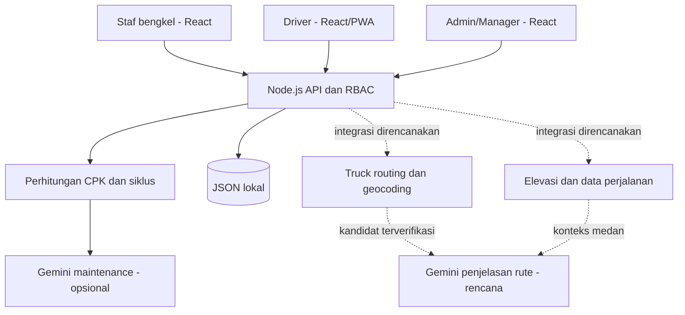

# KiloMetric — Arah Produk dan Pengembangan

> Disusun oleh AI berdasarkan kebutuhan dan keputusan pengguna dalam percakapan proyek ini. Tanggal awal: 13 Oktober 2026. Pembaruan terakhir: 16 Oktober 2026. Dokumen ini adalah panduan kerja yang perlu diperbarui bersama implementasi, bukan pernyataan bahwa seluruh rencana sudah selesai atau disetujui.

## Panduan modul dan rumus lengkap

Lihat [MODUL_DAN_RUMUS.md](MODUL_DAN_RUMUS.md) untuk penjelasan setiap modul, input/output, hubungan data, rumus sesuai kode, contoh angka, aturan unknown/nol, snapshot, validasi, dan kontrak API. Panduan tersebut juga membedakan CPK katalog per unit-kilometer, CPK kelompok Mix optimizer, serta estimasi order dan trip aktual.

## 1. Tujuan aplikasi

KiloMetric membantu perusahaan logistik memahami biaya pemeliharaan setiap kilometer, mengetahui umur dan biaya setiap spare part, serta memilih merek komponen berdasarkan bukti penggunaan. Arah berikutnya adalah membantu pengemudi memilih rute tercepat yang sesuai dengan kendaraan dan muatannya, sambil memperlihatkan perkiraan biaya perjalanan.

Sumber awal datanya adalah pekerjaan nyata: truk masuk bengkel, staf mencatat odometer dan pekerjaan, lalu sistem menghitung hasilnya. Staf tidak perlu mengetik angka CPK atau menebak umur spare part. Saat penggantian berikutnya tercatat, umur komponen sebelumnya dapat ditutup dan CPK akhirnya dihitung.

Otomatis di sini berarti **perhitungan dan pembaruan berdasarkan catatan operasional**. Informasi yang belum berasal dari sensor atau integrasi, seperti biaya faktur, posisi komponen, dan muatan, tetap harus dimasukkan atau dikonfirmasi oleh orang yang bertanggung jawab.

### Hasil bisnis yang dituju

- Manajer melihat truk mana yang biaya perawatannya tinggi dan catatan apa yang membentuk angka itu.
- Bengkel membandingkan merek pada model truk, penggunaan, kategori, dan posisi yang sebanding.
- Pengemudi mengawali perjalanan dengan kendaraan terpilih, lokasi awal, spesifikasi, dan muatan yang jelas.
- Dispatcher/manajer menilai alternatif rute berdasarkan kesesuaian truk, waktu tiba, dan biaya yang terpisah dengan jelas.
- Gemini menjelaskan bukti dan kekurangan data agar keputusan mudah dipahami.

## 2. Keputusan kebutuhan yang sudah diberikan pengguna

| Area | Arah yang sudah dipilih |
| --- | --- |
| Teknologi | Frontend JavaScript + React; backend Node.js |
| Versi pertama | Demo lokal dengan data contoh; layanan eksternal menyusul saat kunci tersedia |
| CPK utama | Semua biaya maintenance tercatat dibagi kilometer sejak awal pelacakan |
| CPK spare part | Setiap pemasangan punya siklus umur; penggantian mengakhiri siklus sebelumnya |
| Best mix | Bandingkan merek komponen untuk model truk dan rekomendasikan kombinasi dengan CPK rendah |
| Awal operasional | Mulai dari truk masuk bengkel dan staf mengisi catatan workshop |
| Akses pengguna | RBAC: akun dan wewenang berbeda untuk admin, manajer, bengkel, dan pengemudi |
| Sebelum berangkat | Pengemudi login, mengisi/mengonfirmasi spesifikasi serta muatan |
| Titik awal perjalanan | Lokasi pengemudi dari GPS ponsel |
| Prioritas rute | Kedatangan tercepat; jalan tol diperbolehkan |
| Kondisi Indonesia | Perhatikan jalan menanjak, menurun, dan kesesuaian jalan untuk truk |
| Ponsel | Arah PWA agar aplikasi dapat dipasang dan menggunakan GPS |
| Maps dan Gemini | Sediakan tempat konfigurasi kunci terlebih dahulu |

Pemilihan penyedia truck routing, cakupan wilayah pilot, sumber data bahan bakar, dan kebutuhan GPS saat layar terkunci masih perlu diputuskan. Roadmap di dokumen ini merupakan usulan implementasi untuk memenuhi keputusan di atas.

## 3. Status proyek yang sebenarnya

Gunakan empat label berikut saat mendiskusikan pekerjaan:

- **Tersedia:** sudah ada di kode demo. Bukan berarti sudah diuji operasional di perusahaan.
- **Placeholder:** bentuk konfigurasi atau kontrak awal sudah ada, tetapi fungsi layanan belum berjalan.
- **Rencana:** belum diimplementasikan.
- **Perlu keputusan:** informasi bisnis atau pilihan teknis belum ditentukan.

| Fitur | Status pada tanggal acuan | Batas yang perlu dipahami |
| --- | --- | --- |
| Katalog truk dan spare part | Tersedia | Data lokal JSON; belum ada stok gudang |
| Catatan maintenance dan registrasi truk saat kunjungan pertama | Tersedia | Kelengkapan biaya dan odometer bergantung pada staf |
| CPK truk dan armada | Tersedia | Berdasarkan biaya maintenance yang tercatat |
| Siklus dan CPK spare part | Tersedia | Diturunkan dari kategori + posisi pemasangan; belum ada nomor seri fisik |
| Tampilan CPK pada katalog spare part | Tersedia | Ringkasan dapat menggabungkan posisi/profil; gunakan optimizer untuk perbandingan lebih spesifik |
| Mix optimizer | Tersedia | Memilih pemenang komponen secara terpisah; belum membuktikan kombinasi keseluruhan |
| Analisis Gemini maintenance | Tersedia, opsional | Membutuhkan kunci dan akses model; belum diverifikasi dengan panggilan live |
| Login, RBAC, dan penugasan truk | Tersedia | Sesi masih di memori server dan berakhir saat server restart |
| Deklarasi spesifikasi, muatan, dan pencatatan perjalanan | Tersedia | Batas teknis masih deklarasi pengguna, bukan verifikasi pabrikan |
| GPS ponsel | Tersedia | Foreground, online, izin lokasi; bukan pelacak latar belakang |
| Kerangka PWA dan halaman offline | Tersedia | Belum diuji pemasangan pada ponsel nyata; tidak ada antrean input offline |
| OCR delivery order dan penugasan | Tersedia, opsional Gemini | Draft perlu review admin; multi-stop; driver/truk sesuai penugasan |
| Jarak/ETA delivery order Google Maps | Tersedia, membutuhkan key | DRIVE, urutan stop tetap; belum verifikasi batas truk |
| Alternatif rute truk untuk driver (ORS `driving-hgv`) | Tersedia, membutuhkan `ORS_API_KEY` | Restriksi OSM Indonesia parsial; beban as, jembatan, larangan truk, jam operasi tidak diketahui; tol tidak diketahui; alternatif hanya ≤ ±70 km garis lurus; geocoding alamat jalan sering hanya pusat kota |
| Penjelasan rute oleh Gemini | Tersedia, opsional | Hanya menjelaskan kandidat provider; id di luar kandidat ditolak; kuota/akses model menentukan ketersediaan |
| Aplikasi mobile driver (React Native/Expo) | Rencana, spesifikasi di `design.md` | Login bearer, rute, GPS foreground/background, antrean offline |
| Peta visual web, navigasi turn-by-turn | Placeholder | Driver diarahkan membuka Google Maps/Waze |
| Elevasi sebagai biaya, biaya tanjakan/turunan | Rencana | Ada total tanjakan/turunan dari ORS, tetapi belum ada model biaya terkalibrasi |
| Database produksi, audit trail, multi-perusahaan | Rencana | Belum ada dalam demo |

Pada pembaruan delivery order, 19 tes otomatis dengan mock provider dan build produksi berhasil. Pengujian tersebut tidak membuktikan akurasi rute Indonesia, GPS pada perangkat nyata, instalasi PWA, atau kualitas jawaban Gemini live. Pembaruan runtime delivery order dijelaskan pada bagian 21.

## 4. Istilah dan batas perhitungan

**Katalog spare part** adalah definisi produk: SKU, nama, merek, kategori, kecocokan model, dan harga default. Satu SKU dapat digunakan banyak kali pada banyak truk.

**Pemasangan** adalah kejadian produk dipasang pada truk tertentu, pada posisi tertentu, dengan odometer, tanggal, jumlah, harga aktual, dan biaya pemasangan. Riwayat umur melekat pada pemasangan ini, bukan hanya pada nama produk.

**Siklus komponen** dimulai saat pemasangan dan berakhir saat posisi tersebut diganti. Komponen yang masih digunakan belum memiliki umur akhir yang diketahui.

**CPK maintenance aktual** berasal dari biaya yang sudah dicatat. **Perkiraan biaya maintenance perjalanan** menggunakan CPK historis untuk mengalokasikan estimasi biaya pada jarak perjalanan. Kedua angka ini berbeda dan tidak boleh dijumlahkan sebagai pengeluaran baru.

**Biaya perjalanan keseluruhan** dapat mencakup maintenance, bahan bakar, tol, dan biaya lain. Perkiraan trip GPS yang lama tetap maintenance saja. Modul delivery order kini memisahkan estimasi maintenance, BBM, dan tol serta total CPK perjalanan; lihat pembaruan di bawah.

Mata uang demo adalah IDR. Jarak odometer menggunakan kilometer. Pengguna tidak perlu mengisi CPK secara manual.

## 5. Alur kerja bengkel sebagai fondasi

### 5.1 Kunjungan pertama

1. Staf bengkel login dengan peran Workshop.
2. Pilih truk yang sudah terdaftar atau daftarkan truk baru langsung dalam form maintenance.
3. Isi plat, model, profil penggunaan, tanggal, odometer, dan workshop.
4. Tambahkan pekerjaan: spare part, posisi, jumlah, harga aktual, dan biaya pemasangan.
5. Isi biaya tenaga kerja umum dan biaya maintenance lain tanpa menghitung ulang biaya pemasangan yang sudah dimasukkan pada baris komponen.
6. Periksa ringkasan biaya lalu simpan.
7. Sistem menyimpan truk dan kunjungan bersama-sama, menetapkan baseline otomatis untuk truk baru, dan membuka siklus komponen yang dipasang.

Pada odometer awal, jarak pelacakan masih nol sehingga CPK tampil belum diketahui. Biaya kunjungan pertama tetap disimpan sebagai bagian total biaya sejak pelacakan dimulai. Ini adalah definisi akuntansi demo; bukan klaim tentang seluruh biaya sejak truk dibeli.

### 5.2 Kunjungan berikutnya

Staf memilih truk, memasukkan odometer baru, lalu mencatat pekerjaan dan harga yang benar-benar dibayar. Sistem memperbarui odometer, biaya kumulatif, dan CPK truk.

Jika kategori dan posisi yang sama dipasang kembali, siklus lama ditutup meskipun mereknya berbeda. Siklus baru dibuka untuk komponen pengganti. Penggantian ban depan kiri tidak boleh menutup siklus ban depan kanan.

### 5.3 Koreksi data

Edit atau penghapusan kunjungan membuat angka turunan dihitung ulang. Untuk truk yang didaftarkan melalui bengkel, kunjungan lebih awal yang ditambahkan belakangan dapat memindahkan baseline otomatis. Baseline truk yang sebelumnya didaftarkan manual dipertahankan.

Odometer yang dilaporkan terpisah, termasuk saat perjalanan, dipertahankan saat catatan bengkel dikoreksi. Sistem memvalidasi hubungan tanggal dan odometer. Ke depan, perubahan semacam ini harus memiliki alasan koreksi dan audit trail; audit trail belum tersedia sekarang.

## 6. Rumus CPK dan contoh

### 6.1 Biaya kunjungan

```text
Biaya baris komponen = jumlah × harga satuan aktual + biaya pemasangan baris
Biaya kunjungan = jumlah semua biaya baris + tenaga kerja umum + biaya lain
```

Harga katalog adalah default pengisian. Harga yang disimpan di kunjungan adalah dasar perhitungan. Mengubah harga katalog tidak mengubah faktur maintenance yang sudah tersimpan.

### 6.2 CPK truk

```text
Jarak terpantau = odometer saat ini − odometer baseline
CPK truk = total biaya maintenance tercatat / jarak terpantau
```

Contoh:

| Kejadian | Odometer | Biaya maintenance |
| --- | ---: | ---: |
| Kunjungan pertama | 100.000 km | Rp1.000.000 |
| Kunjungan kedua | 110.000 km | Rp1.500.000 |

Jarak = 10.000 km. Biaya = Rp2.500.000. CPK = **Rp250/km**. Jika odometer kemudian dilaporkan 112.000 km tanpa biaya baru, CPK menjadi sekitar **Rp208,33/km** karena jaraknya bertambah.

CPK nol bukan pengganti untuk jarak nol. Jika jarak belum tersedia atau nol, tampilkan belum diketahui. Biaya bahan bakar, pembelian truk, dan tol tidak masuk CPK maintenance saat ini.

### 6.3 CPK armada

```text
CPK armada = total biaya maintenance semua truk / total jarak terpantau semua truk
```

Contoh: truk A menghabiskan Rp2.000.000 selama 10.000 km, truk B Rp9.000.000 selama 30.000 km. CPK armada = Rp11.000.000 / 40.000 = **Rp275/km**. Rata-rata sederhana dari Rp200 dan Rp300 adalah Rp250/km dan tidak tepat untuk total armada.

Biaya yang sudah tercatat pada truk dengan jarak nol tetap merupakan pengeluaran armada. Dashboard perlu mempertahankan konteks bahwa sebagian kendaraan belum mempunyai jarak pelacakan yang cukup.

### 6.4 CPK satu spare part

```text
Umur kilometer = odometer penggantian − odometer pemasangan
CPK siklus = biaya pemasangan komponen / umur kilometer
```

Contoh ban depan kiri: harga Rp4.000.000, biaya pemasangan Rp200.000, dipasang pada 100.000 km dan diganti pada 160.000 km. Umurnya 60.000 km. CPK akhir = Rp4.200.000 / 60.000 = **Rp70/km**.

Biaya tenaga kerja umum kunjungan tetap masuk CPK truk, tetapi saat ini tidak dialokasikan ke ranking setiap spare part. Karena itu jumlah seluruh CPK komponen tidak otomatis sama dengan CPK truk.

### 6.5 Catatan pemasangan berkelompok

Jika staf memasukkan dua ban dalam satu baris, jumlah 2 dan posisi `front axle pair`, sistem mempunyai satu catatan siklus bersama. Misalnya total biaya Rp8.400.000 dan jarak 60.000 km:

- CPK kelompok = Rp140/km.
- CPK per unit = Rp70/km, dengan pembagian biaya merata dan asumsi umur yang sama.

Ini tidak membuktikan kedua ban fisik memiliki umur individual yang identik. Untuk pelacakan per ban, gunakan jumlah 1 dengan posisi berbeda, misalnya `front-left tire` dan `front-right tire`.

Ringkasan katalog memakai:

```text
CPK per unit katalog = Σ biaya siklus selesai / Σ(jumlah unit × umur kilometer)
Rata-rata umur = Σ(jumlah unit × umur kilometer) / Σ jumlah unit
```

Hanya siklus selesai dengan jarak positif masuk agregasi tersebut. Komponen aktif dan siklus selesai pada jarak nol tidak dijadikan bukti umur akhir.

## 7. Riwayat spare part dan best mix

### Perilaku yang sudah ada

Identitas pencocokan siklus saat ini adalah **truk + kategori + posisi**. Posisi mengabaikan perbedaan huruf besar/kecil dan spasi di awal/akhir. Istilah yang berbeda, misalnya `depan kiri` dan `front-left`, tetap dianggap berbeda; normalisasi bahasa otomatis belum ada.

Halaman Spare parts & CPK menyediakan ringkasan CPK, umur rata-rata, jumlah siklus/unit selesai, unit aktif, filter model, dan rincian siklus. Mix optimizer memisahkan pembanding berdasarkan model, profil penggunaan, kategori, dan posisi.

Rekomendasi kombinasi dibentuk dari pilihan komponen dengan CPK teramati terendah pada kelompok sebanding. Rekomendasi ini belum mengukur pengaruh interaksi antar-komponen atau membuktikan penghematan satu kombinasi pada seluruh kendaraan.

### Perbaikan yang disarankan

1. Buat pilihan posisi standar per model/konfigurasi agar staf tidak perlu mengetik posisi bebas.
2. Beri ID pemasangan fisik yang permanen; tambahkan nomor seri bila komponen memang memilikinya.
3. Pisahkan kejadian pemasangan, pelepasan, penggantian, rotasi, reparasi, dan pemakaian ulang.
4. Simpan alasan akhir umur: aus normal, rusak, kecelakaan, atau diganti preventif.
5. Simpan snapshot konfigurasi model/profil/kategori saat transaksi agar perubahan master data tidak mengubah klasifikasi riwayat diam-diam.
6. Tampilkan jumlah sampel, distribusi umur, dan konteks rute/muatan sebelum menyebut suatu merek lebih baik.

Rotasi ban antarposisi atau pemindahan komponen antartruk belum didukung oleh model siklus sederhana saat ini. Jangan merekayasa catatan penggantian untuk mewakilinya. Model kejadian fisik perlu dikembangkan lebih dahulu jika alur itu diperlukan.

## 8. Pengguna dan RBAC

| Tindakan | Admin | Manager | Workshop | Driver |
| --- | --- | --- | --- | --- |
| Mengelola truk, katalog, maintenance | Ya | Ya | Ya | Tidak |
| Membaca data truk | Semua | Semua | Semua | Truk yang ditugaskan |
| Memicu analisis Gemini manual | Ya | Ya | Tidak | Tidak |
| Melihat perjalanan | Semua | Semua | Tidak | Milik sendiri |
| Memulai/mengirim GPS/menyelesaikan perjalanan | Tidak | Tidak | Tidak | Milik sendiri, truk ditugaskan |
| Mengelola akun dan penugasan | Ya | Tidak | Tidak | Tidak |
| OCR, review, dan penugasan delivery order | Ya | Tidak | Tidak | Tidak |
| Membaca delivery order | Semua | Tidak | Tidak | Milik sendiri |

Pembatasan harus berlaku di server, bukan hanya menyembunyikan tombol. Driver mendapat data truk yang ditugaskan, katalog kompatibel, dan riwayat maintenance yang terkait; ia tidak mendapat akses menulis catatan bengkel atau perjalanan pengemudi lain.

Akun dibuat admin. Password menggunakan hash scrypt dengan salt. Cookie sesi menggunakan HttpOnly dan SameSite=Strict; opsi Secure disiapkan untuk HTTPS. Sesi berakhir setelah 12 jam atau restart server. Perubahan akun mencabut sesi akun tersebut. Sistem mencegah hilangnya admin aktif terakhir.

Dispatcher belum menjadi role tersendiri. Untuk saat ini fungsi pengawasan perjalanan berada pada Manager/Admin. Jika perusahaan membutuhkan dispatcher terpisah, matriks hak akses perlu diperluas secara eksplisit.

Akun demo memiliki password publik sebagaimana tercantum di README. Untuk penggunaan nyata, bootstrap admin non-demo dan ubah/nonaktifkan akun contoh. Mengubah `DEMO_MODE` pada database yang sudah ada tidak otomatis mengganti akun tersebut.

## 9. Alur perjalanan pengemudi saat ini

1. Login dan pilih salah satu truk yang ditugaskan.
2. Ambil lokasi awal dari GPS dengan izin pengemudi.
3. Masukkan tujuan, odometer keberangkatan, tinggi/lebar/panjang kendaraan, jumlah as, berat kosong, berat maksimum yang diizinkan, berat muatan, dan klasifikasi barang berbahaya.
4. Konfirmasi spesifikasi serta muatan untuk keberangkatan itu. Data tersimpan sebelumnya membantu pengisian, tetapi muatan perjalanan baru tetap harus diisi.
5. Karena routing belum terhubung, konfirmasi bahwa rute telah disetujui dispatcher melalui perencanaan eksternal.
6. Mulai pencatatan perjalanan dan tekan Resume live GPS agar lokasi dikirim saat aplikasi terlihat dan online.
7. Saat tiba, masukkan odometer aktual dan selesaikan perjalanan.

Satu pengemudi atau truk hanya boleh memiliki satu perjalanan aktif. Berat kosong ditambah muatan tidak boleh melampaui berat maksimum yang dideklarasikan. Ini belum memvalidasi beban tiap as atau memastikan batas deklarasi sesuai dokumen pabrikan.

Lokasi awal harus baru dan memiliki akurasi dalam 100 meter. Backend menolak data lokasi tidak valid, mengabaikan timestamp berulang/tidak meningkat, dan memfilter lompatan yang tidak masuk akal. Jarak GPS adalah pendekatan dari titik yang diterima dan berbeda dari jarak jalan atau odometer.

Odometer keberangkatan/kedatangan memperbarui jarak truk untuk CPK. GPS tidak otomatis menggantikan odometer sebagai sumber resmi. Riwayat titik terbaru dibatasi sampai 10.000 titik per perjalanan; jarak GPS kumulatif tetap terpisah. Ringkasan polling mengirim lokasi terakhir dan jumlah titik, bukan seluruh jejak.

```text
Estimasi maintenance perjalanan = CPK historis saat keberangkatan × jarak odometer perjalanan
```

Contoh CPK Rp250/km dan perjalanan 400 km menghasilkan estimasi Rp100.000. Angka ini bukan faktur baru dan tidak ditambahkan ke numerator CPK. BBM, tol, dan pengaruh elevasi belum termasuk.

## 10. Rancangan routing Indonesia

### 10.1 Urutan pengambilan keputusan

Prioritas pengguna adalah waktu tiba tercepat, dengan tol diperbolehkan. Namun alternatif harus terlebih dahulu memenuhi batas kendaraan dan jalan.

```text
Lokasi awal + tujuan + snapshot truk/muatan
  → geocoding dan kandidat rute dari penyedia truck routing
  → verifikasi batas/larangan dan kelengkapan data
  → keluarkan kandidat yang tidak sesuai
  → urutkan kandidat layak menurut ETA
  → tampilkan perbandingan jarak, tol, elevasi, estimasi biaya
  → Gemini menjelaskan berdasarkan data kandidat
  → pengemudi/dispatcher memilih dan menyimpan rencana
```

Jika tidak ada kandidat yang dapat diverifikasi, aplikasi harus mengatakan tidak ada rute yang dapat direkomendasikan dari data tersedia. Garis lurus, rute mobil biasa, atau tebakan Gemini tidak boleh diberi label sebagai rute truk yang sudah diverifikasi.

### 10.2 Input dan output yang diusulkan

| Input | Kegunaan |
| --- | --- |
| Koordinat awal dan tujuan yang sudah diverifikasi | Menentukan perjalanan yang benar |
| Dimensi keseluruhan kendaraan dan muatan | Batas tinggi, lebar, panjang, dan kecocokan akses |
| Berat total serta konfigurasi/beban as jika tersedia | Pembatasan jalan dan jembatan |
| Barang berbahaya dan kelas kendaraan | Pembatasan khusus berdasarkan dukungan penyedia |
| Waktu keberangkatan | ETA dan pembatasan berbasis waktu jika didukung |
| Kebijakan tol | Tol diperbolehkan sesuai keputusan pengguna |

Output rencana perlu mencakup geometri rute, jarak, ETA dan waktu pengambilannya, penyedia, batas yang sudah diperiksa, batas yang belum diketahui, biaya tol bila tersedia, profil elevasi, serta alasan rekomendasi. Data rencana disimpan sebagai snapshot agar rute yang dipilih dapat diaudit setelah kondisi layanan berubah.

### 10.3 Peta berbeda dengan truck routing

Peta menampilkan jalan. Geocoding mengubah alamat menjadi koordinat. Truck routing mencari rute dengan batas kendaraan. Elevation menyediakan tinggi medan. Data lalu lintas memperbarui ETA. Satu API key tidak otomatis menyediakan semua kemampuan ini.

Pilih provider setelah memeriksa cakupan **pembatasan truk di wilayah operasi Indonesia**, bukan hanya ketersediaan peta Indonesia. Lakukan uji rute yang diketahui dispatcher, termasuk akses gudang, jembatan, batas tinggi, larangan truk, dan jam operasi.

Pada acuan dokumentasi proyek ini, Google large-vehicle routing mendokumentasikan cakupan AS daratan dan Jepang, sehingga kemampuan tersebut tidak boleh diasumsikan mencakup Indonesia. Cakupan dan akses layanan perlu diperiksa kembali saat memilih provider. Lihat [dokumentasi large-vehicle routing](https://developers.google.com/maps/documentation/routes/lvr).

### 10.4 Tanjakan dan turunan

Elevasi harus diambil sepanjang geometri jalan, bukan hanya beda tinggi titik awal dan tujuan. Rute yang kembali ke ketinggian semula tetap dapat memiliki banyak tanjakan dan turunan.

```text
Grade segmen (%) = perubahan elevasi / jarak horizontal segmen × 100
```

Perhitungan perlu mengendalikan noise elevasi, resolusi sampel, dan segmen terlalu pendek. Ukuran yang berguna mencakup total pendakian, total penurunan, panjang segmen curam, dan kondisi beban saat melewatinya.

Tanjakan dapat memengaruhi konsumsi energi, sedangkan turunan dapat memengaruhi kebutuhan pengereman. Besar biaya tidak dapat ditentukan hanya dari tanda positif/negatif elevasi. Model, beban, kecepatan, kondisi jalan, lalu lintas, dan teknik berkendara juga berpengaruh.

Jangan membuat konstanta seperti “tanjakan menambah CPK 30%” tanpa kalibrasi. Untuk versi awal, tampilkan profil medan dan keterbatasannya. Estimasi uang berbasis medan menyusul setelah data operasional tersedia dan model diuji.

## 11. Peran Gemini

### Yang sudah dikerjakan

Backend dapat mengirim ringkasan biaya, jarak, katalog kompatibilitas, dan siklus komponen selesai kepada Gemini saat kunci dikonfigurasi. Perubahan data memicu analisis terbaru dengan debounce; status revisi membantu menandai hasil yang belum mengikuti data terbaru. Kegagalan AI tidak membatalkan penyimpanan maintenance.

Ini adalah pemberian konteks terbaru, **bukan melatih ulang atau fine-tuning model setiap ada spare part baru**. Produk baru tanpa siklus selesai belum memiliki bukti umur pakai dari perusahaan.

### Pembagian tanggung jawab

| Tanggung jawab | Pelaksana |
| --- | --- |
| Rumus CPK, penjumlahan biaya, umur siklus | Kode deterministik backend |
| Hak akses, validasi muatan, kepemilikan perjalanan | Backend |
| Jalan, geometri, ETA, pembatasan yang didukung | Provider routing/data yang dipilih |
| Profil elevasi | Provider elevasi dan pemrosesan geometri |
| Menjelaskan perbandingan dan kekurangan bukti | Gemini |
| Memastikan fitment dan kelayakan operasional | Bengkel/dispatcher sesuai tanggung jawab perusahaan |

Untuk routing, Gemini baru boleh diberi kandidat yang berasal dari provider dan hasil pemeriksaan yang jelas. Jawabannya harus merujuk angka serta ID kandidat yang tersedia. Kode harus memvalidasi kandidat yang direkomendasikan benar-benar ada dan memenuhi pemeriksaan sebelum ditampilkan.

Gemini tidak boleh menciptakan kompatibilitas komponen, umur merek tanpa bukti, biaya tol, status jembatan, geometri rute, atau persentase penghematan yang belum dihitung. Jika AI gagal, aplikasi tetap menampilkan angka dan kandidat terverifikasi yang tersedia.

Rencana tambahan: simpan versi model, waktu analisis, revisi data, ringkasan input, dan hasil validasi respons. Pencatatan provenance analisis/rute yang lengkap belum diimplementasikan.

## 12. Arsitektur saat ini dan arah berikutnya



Frontend menangani form, tampilan, dan izin GPS. Backend mengotorisasi setiap permintaan, memvalidasi data, menjalankan perhitungan, dan menyimpan perubahan. Kunci Gemini dan kunci layanan server ditempatkan di backend. Jika provider memerlukan kunci publik untuk browser, gunakan kunci khusus dengan pembatasan origin dan kemampuan sesuai dokumentasi provider; jangan memindahkan secret server ke bundle frontend.

JSON lokal cukup untuk demo satu server. Perubahan diserialisasi dan ditulis melalui file sementara lalu rename. Ini belum menjadi fondasi multi-instance atau database transaksional produksi.

### Peta file untuk pengembang

| File | Tanggung jawab |
| --- | --- |
| `server.js` | HTTP API, integrasi Gemini, autentikasi route, penyajian frontend |
| `lib/auth.js` | Role, password, sesi, penyaringan data pengguna |
| `lib/workshop.js` | Penyimpanan/koreksi maintenance dan sinkronisasi mileage |
| `lib/validation.js` | Validasi data fleet dan maintenance |
| `lib/analytics.js` | Biaya, CPK, siklus komponen, dan perbandingan |
| `lib/trips.js` | Deklarasi truk, perjalanan, validasi GPS, dan odometer |
| `lib/orders.js` | OCR, order, penugasan, Google distance, estimasi biaya, dan hubungan trip |
| `src/orders.jsx`, `src/orders.css` | UI admin delivery order |
| `lib/seed.js` | Data ilustratif awal |
| `src/main.jsx`, `src/style.css` | CMS dan UI utama |
| `src/driver.jsx`, `src/driver.css` | Alur pengemudi dan pengawasan perjalanan |
| `public/manifest.webmanifest`, `public/sw.js` | Identitas PWA dan fallback offline |
| `test/` | Tes otomatis aturan bisnis dan API |
| `.env.example` | Template konfigurasi tanpa kunci asli |
| `data/fleet.json` | Data runtime lokal; tidak untuk dimasukkan ke Git |

### Kontrak API penting saat ini

| Endpoint/kelompok | Maksud |
| --- | --- |
| `/api/session`, `/api/login`, `/api/logout` | Identitas dan sesi |
| `/api/state` | Data dan analytics yang disaring berdasarkan role |
| `/api/users` | Pengelolaan akun oleh admin |
| `/api/trucks`, `/api/parts`, `/api/maintenance` | Operasi master data dan maintenance sesuai role |
| `/api/trips` dan route turunannya | Perjalanan, lokasi, dan penyelesaian milik driver |
| `/api/analyze` | Permintaan analisis maintenance oleh admin/manajer |
| `/api/orders` dan route turunannya | OCR admin, review/assignment, jarak otomatis, dan estimasi order |
| `/api/routes/preview` | Placeholder; input valid tetap menghasilkan unavailable/503 tanpa kandidat rute |

Tabel ini adalah ringkasan tanggung jawab, bukan spesifikasi lengkap payload tiap endpoint. Perubahan kontrak harus diperiksa pada handler dan tes terkait.

### Model data produksi yang diusulkan

Pisahkan entitas pengguna/penugasan, truk/versi konfigurasi, katalog produk, posisi komponen, pemasangan fisik, kunjungan/baris maintenance, kejadian pelepasan/rotasi, perjalanan/snapshot muatan, titik GPS, rencana/segmen rute, analisis AI, dan audit event.

Database relasional seperti PostgreSQL dapat dipertimbangkan untuk relasi, transaksi, indeks, dan migrasi. Pemilihannya belum diputuskan pengguna. Migrasi harus menjaga ID serta nilai harga historis dan dapat diverifikasi terhadap CPK sebelum/sesudah migrasi.

## 13. PWA dan batas GPS ponsel

Kerangka PWA saat ini mencakup manifest, ikon, kontrol pemasangan, service worker pada build produksi, dan halaman status offline. Service worker menyimpan aset publik yang diperlukan untuk fallback; respons API terautentikasi dan data GPS tidak dicache. Belum ada form offline atau antrean pengiriman ulang.

Ponsel harus mengakses alamat HTTPS yang dapat dijangkau. `localhost` pada ponsel menunjuk ponsel itu sendiri, bukan komputer pengembang. Instalasi dan GPS pada ponsel memerlukan pengujian melalui deployment yang sesuai.

**PWA saat ini hanya mendukung GPS saat aplikasi aktif/terlihat.** Layar terkunci, perpindahan aplikasi, izin dicabut, koneksi terputus, atau sesi berakhir dapat menghentikan pengiriman. Tampilan harus menunjukkan status dan umur lokasi terakhir agar manajer tidak menganggap titik lama sebagai posisi live.

Jika perusahaan memerlukan pelacakan kontinu selama perjalanan ketika ponsel terkunci, evaluasi aplikasi native/wrapper dengan kemampuan lokasi latar belakang atau perangkat telematika. Service worker web tidak boleh diasumsikan menyediakan GPS latar belakang kontinu.

Untuk fase offline berikutnya, rancang antrean terenkripsi sesuai perangkat, ID idempotensi, penanganan sesi habis, timestamp, konflik odometer, dan penghapusan data saat logout. Ini pekerjaan tambahan, bukan kemampuan yang sudah tersedia.

Referensi: [Geolocation watchPosition](https://developer.mozilla.org/en-US/docs/Web/API/Geolocation/watchPosition), [spesifikasi Geolocation](https://www.w3.org/TR/geolocation/), dan [persyaratan instalasi PWA](https://developer.mozilla.org/en-US/docs/Web/Progressive_web_apps/Guides/Making_PWAs_installable).

## 14. Konfigurasi, penyimpanan, dan operasional

| Variabel | Fungsi/status |
| --- | --- |
| `GEMINI_API_KEY` | Mengaktifkan analis maintenance yang sudah diimplementasikan |
| `GEMINI_MODEL` | Nama model generateContent yang tersedia untuk akun; verifikasi sebelum pemakaian |
| `MAPS_API_KEY` | Adapter jarak/ETA Google Routes untuk delivery order; peta visual dan pembatasan truk belum tersedia |
| `GEMINI_OCR_MODEL` | Override opsional model ekstraksi; default memakai GEMINI_MODEL |
| `TRUCK_ROUTING_PROVIDER`, `TRUCK_ROUTING_API_KEY` | Slot penyedia routing; adapter belum tersedia |
| `ELEVATION_API_KEY` | Slot elevasi; adapter belum tersedia |
| `PORT`, `HOST` | Alamat server; default loopback untuk demo |
| `APP_ORIGIN`, `COOKIE_SECURE` | Konfigurasi origin dan cookie untuk deployment HTTPS |
| `DEMO_MODE`, `ADMIN_EMAIL`, `ADMIN_PASSWORD` | Mode demo/bootstrap akun awal |

Jangan menulis kunci asli atau password produksi di dokumen, commit, screenshot, atau respons API. `.env.example` hanya template. Ketersediaan model, kuota, biaya API, dan cakupan provider harus diperiksa saat integrasi; dokumen ini tidak menetapkan harga layanan.

Backup UI adalah snapshot data bisnis untuk review, bukan backup pemulihan lengkap. Untuk pemulihan lengkap saat ini, hentikan server dan salin `data/fleet.json` secara aman. File itu juga memuat data akun dan riwayat lokasi. Prosedur restore perlu diuji sebelum pilot produksi.

Langkah menjalankan aplikasi ada di [README](README.md). Ringkasnya:

```sh
npm install
npm run dev
```

Buka `http://localhost:3000`. Untuk pemeriksaan dan build:

```sh
npm test
npm run build
npm start -- --production
```

## 15. Roadmap dengan kriteria selesai

Urutan berikut adalah rekomendasi. Fase yang membutuhkan provider/kunci dapat disiapkan kontraknya dahulu, tetapi klaim rute live menunggu data nyata.

### Fase A — Validasi alur maintenance yang tersedia

**Tujuan:** staf dapat mencatat pekerjaan nyata dan menelusuri angka CPK.

Pekerjaan: uji beberapa kunjungan representatif, konsistensi istilah posisi, harga aktual, biaya umum, koreksi odometer, dan penambahan truk saat kunjungan.

**Selesai ketika:** contoh biaya dapat direkonsiliasi dengan catatan bengkel; kunjungan pertama tidak menghasilkan CPK palsu; pergantian merek menutup siklus yang tepat; koreksi tidak merusak mileage yang dilaporkan melalui perjalanan.

### Fase B — Perkuat pelacakan spare part fisik

**Tujuan:** satu komponen memiliki riwayat yang dapat ditelusuri meski dipindah atau diperbaiki.

Pekerjaan: posisi standar, ID pemasangan, snapshot master data, alasan pelepasan, dan audit koreksi. Tambahkan rotasi/pemakaian ulang hanya setelah kebutuhannya dipastikan. Pertahankan label untuk data lama berkelompok.

**Selesai ketika:** mengganti satu ban tidak menutup ban lain; riwayat pemasangan tetap stabil setelah master diedit; kasus rotasi yang disepakati tidak dihitung sebagai umur selesai palsu; hasil migrasi cocok dengan baseline perhitungan yang disetujui.

### Fase C — Pilot driver dan PWA pada perangkat nyata

**Tujuan:** login, deklarasi muatan, GPS foreground, dan penyelesaian perjalanan bekerja di ponsel target.

Pekerjaan: deployment HTTPS terbatas, akun non-demo, pengujian Android/iPhone yang digunakan, izin ditolak/dicabut, kehilangan koneksi, sesi habis, serta resume perjalanan. Tentukan apakah foreground cukup untuk bisnis.

**Selesai ketika:** akses antar-driver tetap terisolasi; muatan berlebih ditolak; titik lama ditandai; perjalanan dapat dilanjutkan setelah gangguan; kebutuhan background mendapat keputusan arsitektur yang jelas.

### Fase D — Integrasi rute tercepat yang sesuai truk

**Tujuan:** mengganti placeholder dengan alternatif rute nyata yang memiliki provenance.

Pekerjaan: pilih provider dan verifikasi cakupan wilayah pilot; implementasikan geocoding, peta, truck routing, ETA, dan snapshot. Tambahkan elevasi jika data tersedia. Gemini menjelaskan alternatif yang telah diperiksa.

**Selesai ketika:** kandidat yang melanggar batas diketahui dikeluarkan; kandidat layak tercepat diprioritaskan dengan tol diperbolehkan; alasan penolakan dan batas yang tidak diketahui terlihat; kegagalan provider menghasilkan status jelas; tidak ada rute fiktif saat key kosong.

### Fase E — Estimasi biaya perjalanan berbasis bukti

**Tujuan:** memisahkan proyeksi maintenance, BBM, dan tol secara dapat diuji.

Pekerjaan: tentukan sumber BBM dan tol aktual, gabungkan konteks muatan/medan, ukur kesalahan prediksi, dan lakukan validasi pada perjalanan yang tidak digunakan untuk kalibrasi. Pisahkan data ilustratif dari data perusahaan.

**Selesai ketika:** setiap komponen biaya memiliki sumber dan satuan; rentang ketidakpastian dapat dijelaskan; biaya estimasi tidak masuk biaya aktual; pengaruh medan diuji dengan data, bukan pengali tebakan.

### Fase F — Kesiapan operasional perusahaan

**Tujuan:** menjalankan aplikasi dengan data nyata dan prosedur pemulihan yang jelas.

Pekerjaan: database/migrasi, audit trail, sesi persisten, monitoring, restore drill, pembatasan akses lokasi, retensi data, dan mekanisme operasional saat provider gagal. Tambahkan multi-perusahaan hanya jika memang diperlukan.

**Selesai ketika:** restore berhasil diuji; hak akses dan perubahan data dapat diaudit; sistem mengomunikasikan outage; akses dan umur simpan data lokasi disepakati; kapasitas diuji sesuai jumlah pengguna/truk pilot.

## 16. Skenario penerimaan utama

| Skenario | Hasil yang diharapkan |
| --- | --- |
| Truk baru, kunjungan pertama | Biaya tersimpan, baseline otomatis, CPK belum diketahui |
| Kunjungan kedua dengan odometer lebih tinggi | CPK dihitung dari seluruh biaya dan selisih odometer |
| Harga katalog berubah | Harga aktual maintenance lama tetap sama |
| Ban kiri diganti dengan merek lain | Siklus ban kiri lama selesai; siklus kanan tetap aktif |
| Catatan dua ban dalam satu baris | Tetap berlabel kelompok; per-unit dinyatakan sebagai alokasi |
| Spare part belum pernah diganti | Aktif, tanpa umur akhir atau ranking umur yang dibuat-buat |
| Dua truk menempuh jarak berbeda | CPK armada menggunakan rasio total, bukan mean sederhana |
| Driver mengakses truk/perjalanan bukan miliknya | Server menolak akses sesuai penugasan/kepemilikan |
| Berat total melampaui batas deklarasi | Keberangkatan ditolak |
| GPS ditolak, terlalu lama, atau tidak akurat | Status jelas; persyaratan keberangkatan tidak dilewati diam-diam |
| GPS berulang atau melompat tidak masuk akal | Tidak menambah jarak secara tidak valid |
| Trip selesai | Odometer memperbarui CPK; estimasi trip tidak menjadi biaya maintenance baru |
| Gemini gagal | Catatan maintenance tetap tersimpan; analisis menunjukkan kegagalan/stale |
| Routing belum terhubung | Unavailable, tanpa ETA atau jalan rekaan |
| Rute cepat melewati batas tinggi terlalu rendah | Pada fase routing, kandidat ditolak sebelum pemilihan tercepat |
| Ponsel offline/layar terkunci | Keterbatasan tracking terlihat; lokasi terakhir tidak diklaim live |

Skenario routing dan perangkat nyata di tabel ini adalah kriteria pengujian mendatang. Jangan menyebut semuanya telah lolos hanya karena tes unit demo berhasil.

## 17. Kualitas data dan interpretasi

CPK rendah dapat terjadi karena catatan maintenance belum lengkap, odometer terlalu tinggi, atau periode pelacakan pendek. Perbandingan merek dapat dipengaruhi muatan, jalan, operator, dan alasan penggantian. Data contoh tidak boleh dipakai untuk keputusan pembelian sebenarnya.

Kelengkapan biaya, sumber odometer, jumlah siklus, dan profil penggunaan perlu dapat dilihat bersama hasil. Sample count bukan ukuran kepastian statistik dengan sendirinya. Performa aktif belum sama dengan umur akhir; komponen yang masih hidup tidak boleh diperlakukan sebagai kegagalan atau dibuang dari pemahaman risiko secara sembarang.

Tidak semua data jalan memiliki kelengkapan atau kebaruan yang sama. Tampilkan sumber dan keterbatasan agar dispatcher dapat melakukan pemeriksaan operasional. “Sesuai truk” harus dijelaskan sebagai pemeriksaan terhadap batas yang tersedia, bukan jaminan semua kondisi jalan telah diketahui.

## 18. Keputusan yang masih diperlukan

1. **Wilayah pilot:** kota/provinsi, jenis perjalanan, akses gudang, dan ruas yang sering dilewati.
2. **Provider routing:** kandidat dengan cakupan pembatasan truk Indonesia, izin penggunaan, dan biaya yang sesuai.
3. **GPS background:** cukup saat aplikasi terbuka, atau wajib tetap berjalan saat layar terkunci?
4. **Data BBM:** tersedia liter, harga, odometer pengisian, telematika, atau hanya tagihan agregat?
5. **Data tol:** estimasi provider, transaksi aktual, atau input pengemudi/staf?
6. **Identitas komponen:** posisi saja cukup untuk pilot, atau perlu serial, rotasi ban, reparasi, dan perpindahan antartruk sejak awal?
7. **Sumber spesifikasi:** siapa menyetujui batas pabrikan, dokumen kendaraan, dan beban per as?
8. **Peran dispatcher:** memakai Manager atau membutuhkan role khusus?
9. **Data lokasi:** siapa boleh melihat jejak rinci dan berapa lama disimpan?
10. **Skala dan hosting:** jumlah truk/pengguna awal, kebutuhan banyak cabang/perusahaan, dan lingkungan deployment.

Jawaban dapat ditambahkan bertahap; pekerjaan maintenance yang tidak bergantung pada keputusan tersebut tetap dapat dilanjutkan.

## 19. Cara memakai dokumen ini bersama Codex

Pengguna dapat memberi instruksi langsung melalui percakapan. Contoh:

> Baca ARAH_PENGEMBANGAN.md. Kerjakan Fase B untuk posisi spare part standar terlebih dahulu. Pertahankan harga aktual historis dan perhitungan CPK. Perbarui status dokumen serta tes yang terkait, lalu jelaskan perubahan dan batasnya.

Atau:

> Saya sudah memilih provider routing dan punya key. Implementasikan adapter Fase D berdasarkan dokumentasi resmi provider, simpan secret di backend, dan tampilkan unavailable jika layanan gagal.

Sebelum suatu tahap disebut selesai, perbarui matriks status, catat validasi yang benar-benar dijalankan, dan jelaskan hal yang belum diuji. README tetap menjadi panduan menjalankan aplikasi; dokumen ini menjadi acuan tujuan, aturan bisnis, serta urutan pengembangan.

## 20. Referensi teknis

- [README proyek](README.md): menjalankan aplikasi, akun demo, konfigurasi, dan batas implementasi.
- [Gemini generateContent](https://ai.google.dev/api/generate-content): acuan API analis AI.
- [Google large-vehicle routing](https://developers.google.com/maps/documentation/routes/lvr): pemeriksaan cakupan dan batas layanan sebelum memilih provider.
- [MDN Geolocation watchPosition](https://developer.mozilla.org/en-US/docs/Web/API/Geolocation/watchPosition): izin dan penggunaan GPS browser.
- [W3C Geolocation](https://www.w3.org/TR/geolocation/): perilaku dan batas geolokasi web.
- [MDN PWA installation](https://developer.mozilla.org/en-US/docs/Web/Progressive_web_apps/Guides/Making_PWAs_installable): persyaratan pemasangan aplikasi web.

Referensi layanan eksternal dapat berubah. Periksa kembali dokumentasi resmi saat implementasi; tanggal dokumen ini bukan jaminan kemampuan layanan di masa depan.


## 21. Pembaruan 15 Oktober 2026 — Delivery order, OCR, dan estimasi perjalanan

### Kebutuhan tambahan pengguna

Admin mengunggah delivery order/surat jalan. Gemini membaca dokumen menjadi daftar order dengan beberapa tujuan, lalu admin menugaskan pengemudi dan truk. Jarak harus otomatis dari Google Maps, bukan input manual. Estimasi biaya mencakup maintenance, BBM, dan tol.

### Alur yang sudah diimplementasikan

1. Admin membuka **Delivery orders**, memilih PDF/JPEG/PNG/WebP (maksimum 8 MiB), lalu menekan Extract. Dokumen dikirim ke Gemini pada tindakan tersebut.
2. Respons terstruktur divalidasi seluruhnya sebelum penyimpanan. Satu dokumen bisa menghasilkan maksimum 20 draft, tiap order 1–10 stop dan maksimum 100 baris cargo. Tidak ada penugasan otomatis berdasarkan teks dokumen.
3. Admin membandingkan dengan dokumen asli dan memperbaiki reference, pickup, customer, tanggal, setiap alamat/recipient, barang, kuantitas, satuan, dan berat yang tersedia. Nilai yang tidak terbaca tidak boleh dibuat-buat.
4. Admin memilih driver aktif dan truk yang sudah ditugaskan melalui People & access. Berat order diperiksa terhadap kapasitas deklarasi jika spesifikasi tersedia. Review wajib sebelum penugasan tersimpan.
5. Saat order reviewed disimpan, frontend meminta Google Routes secara otomatis jika key dikonfigurasi. Pickup, stop antara, dan stop terakhir dikirim sesuai urutan review. Tidak ada kolom input jarak manual.
6. Sistem menghitung maintenance dari sejarah truk, BBM dari efisiensi dan harga input admin, serta tol dari override admin atau harga driving Google dalam IDR jika tersedia.
7. Driver melihat order miliknya, memilih Use this delivery order, lalu melengkapi pemeriksaan dan GPS. Semua stop melekat pada trip, dengan final stop sebagai tujuan utama.
8. Start/complete trip mengubah status order menjadi in transit/completed. Ini bukan bukti penerimaan setiap stop; proof of delivery dan partial delivery belum tersedia.

### Rumus dan sumber

```text
D = jarak Google Maps, kilometer
M = CPK maintenance historis truk × D
F = (D / efisiensi km per liter) × harga IDR per liter
T = override tol admin jika diisi, atau estimasi tol driving Google jika ada
Total estimasi = M + F + T
CPK estimasi perjalanan = (M + F + T) / D
```

Contoh: D 240 km, maintenance Rp250/km, efisiensi 4 km/liter, BBM Rp10.000/liter, tol Rp150.000. M Rp60.000 + F Rp600.000 + T Rp150.000 = Rp810.000, dengan CPK perjalanan Rp3.375/km. CPK maintenance tetap Rp250/km pada snapshot tersebut.

Jika salah satu komponen tidak diketahui, total tetap unknown. Nol tol harus eksplisit, bukan asumsi karena Google tidak mengembalikan harga. Angka proyeksi tidak ditambahkan ke pengeluaran maintenance aktual. BBM memakai asumsi muatan dari admin; belum ada kalibrasi medan/telematika.

### Batas integrasi yang tetap berlaku

- Google adapter memakai DRIVE traffic-aware, tol diperbolehkan. Rute driving tidak memvalidasi batas tinggi/berat/as truk di Indonesia. Harga tol driving dapat berbeda dengan kelas truk; gunakan override yang sudah diperiksa.
- Urutan stop mengikuti input; belum ada optimasi urutan, perjalanan kembali, atau waktu bongkar muat. ETA driving dihitung saat permintaan, bukan janji waktu penerimaan pada tanggal delivery.
- Gemini membaca dokumen; kilometer dan biaya dihitung oleh Google/backend. Gemini tidak menebak jarak atau melatih ulang diri dari dokumen.
- Adapter truck-safe navigation, elevasi, dan analisis rute Gemini tetap merupakan roadmap, meskipun adapter jarak order sudah ada.
- Kunci kosong menampilkan not configured. Panggilan gagal mempertahankan order yang telah tersimpan. Pengujian live belum dilakukan dengan API key nyata.
- Admin dapat menugaskan order meskipun estimate masih unknown. Driver tetap memerlukan approval rute eksternal; estimate bukan persetujuan jalan.
- Satu order terhubung dengan satu trip. Penggabungan beberapa order ke satu trip, pembatalan, proof of delivery, dan status per-stop belum diimplementasikan.

### Penyimpanan dan akses

`lib/orders.js` menangani validasi, OCR, request Maps, penugasan, biaya, dan hubungan trip. `src/orders.jsx` serta `src/orders.css` menangani UI admin. `server.js` menyediakan `/api/orders`, `/api/orders/extract`, `/api/orders/:id`, dan `/api/orders/:id/estimate`. `test/orders.test.js` menguji kontrak tersebut menggunakan provider mock.

Data runtime bermigrasi dengan menambahkan `orders: []` dan schemaVersion 3 tanpa menghapus riwayat lama. Dokumen asli tidak disimpan: hanya hasil ekstraksi, metadata sumber, hash, peringatan, dan waktu. Upload identik ditolak berdasarkan hash. Simpan dokumen asli secara terpisah jika diperlukan untuk proses perusahaan.

Admin mengelola order. Driver hanya membaca order miliknya; metadata sumber OCR tidak dikirim pada tampilan driver. Manager dan Workshop tidak mendapat data order pada versi ini. Pengubahan order memakai nomor versi; hasil Maps yang tiba setelah order berubah ditolak. Edit order menghapus estimate lama. Setelah trip dimulai, order dan estimate dispatch dibekukan.

### Validasi tambahan

Tes mencakup file salah tipe/terlalu besar, keluaran OCR tidak valid/terpotong, ekstraksi beberapa order, perlindungan duplikat, review wajib, penugasan salah, edit kedaluwarsa, urutan waypoint Google, alamat partial match, provider error, komponen biaya unknown, override tol nol, isolasi role, cargo trip kurang dari order, snapshot semua stop, dan persistence status selesai. Tes tersebut memakai mock, sehingga uji dokumen nyata, key, billing, alamat Indonesia, dan UI perangkat tetap diperlukan.

### Langkah berikutnya

Konfigurasikan GEMINI_API_KEY dan MAPS_API_KEY dengan Routes API aktif; GEMINI_OCR_MODEL opsional. Uji satu surat jalan nyata yang boleh diproses, review seluruh alamat, lalu cocokkan jarak dan estimasi tol dengan operasi perusahaan. Tentukan efisiensi BBM loaded yang representatif untuk tiap truk. Setelah alur dasar tervalidasi, lanjutkan pemilihan truck routing dan kalibrasi medan sesuai roadmap sebelumnya.

Referensi implementasi: [Gemini generateContent](https://ai.google.dev/api/generate-content), [Google computeRoutes](https://developers.google.com/maps/documentation/routes/compute_route_directions), dan [intermediate waypoints](https://developers.google.com/maps/documentation/routes/intermed_waypoints).

## 22. Pembaruan 16 Oktober 2026 — Aplikasi driver dan alternatif rute

### Keputusan

Tim membangun aplikasi mobile driver (React Native + Expo) dan menyambungkan Gemini dengan peta. Pembagian tanggung jawab tetap sesuai §11: provider routing menghitung kandidat rute, Gemini hanya menjelaskan. Google Maps key tidak tersedia, sehingga provider yang dipakai adalah OpenRouteService profil `driving-hgv`, dengan rute contoh (fixture) berlabel jelas sebagai fallback. Spesifikasi lengkap aplikasi dan kontrak API ada di `design.md`; rencana desain di `docs/plans/2026-10-16-driver-app-routing-design.md`.

### Yang diimplementasikan di backend

- Login mobile: `POST /api/login` dengan `client: "mobile"` mengembalikan token untuk header `Authorization: Bearer`. Penyimpanan sesi, masa berlaku 12 jam, dan pencabutan sama dengan cookie web.
- `POST /api/routes/preview` menggantikan placeholder 503: geocoding stop, kandidat rute truk dengan dimensi dan berat deklarasi, penjelasan Gemini yang divalidasi, serta fallback fixture.
- `routePlan`: snapshot rute yang dipilih driver disimpan pada `trip.routing.plan` saat trip dimulai. Persetujuan dispatcher eksternal tetap wajib.

### Temuan uji live (16 Oktober 2026)

| Uji | Hasil |
| --- | --- |
| Jakarta Selatan → Cikarang (±36 km garis lurus) | 3 alternatif, 49–54 km, 55–58 menit |
| Jakarta Selatan → Kawasan Industri Pulogadung | 3 alternatif, geocode `exact` (venue) |
| Jakarta Selatan → Bandung (168 km) | ORS menolak alternatif di atas ±100 km; satu rute 168 km/144 menit beserta peringatan |
| Multi-stop dengan titik di laut | ORS mengembalikan 3108 km; kini dibuang oleh pemeriksaan kewajaran |
| Geocoding "Jl. Asia Afrika No. 8, Bandung" | Hanya pusat kota Bandung (confidence 0.6) → ditandai `approximate` |
| Geocoding "Pelabuhan Tanjung Priok" | Salah tempat (Muara Angke) dengan confidence 1.0 → label hasil wajib ditampilkan ke driver |
| Gemini `gemini-3.8-flash` | Kuota key habis (429) saat uji; kartu AI menampilkan "tidak tersedia" dan rute tetap tampil |

### Batas yang tetap berlaku

Beban per as tidak dideklarasikan, sehingga tidak dikirim ke provider dan ditampilkan sebagai belum diketahui. Batas jembatan, larangan truk, dan jam operasi tidak diperiksa. Tol tidak diketahui. Alternatif rute hanya untuk perjalanan pendek. Alamat order perlu menyebut nama tempat yang dikenal (kawasan industri, gudang bernama) agar geocoding akurat. Kandidat rute adalah estimasi provider, bukan persetujuan jalan.

## 23. Pembaruan 17 Oktober 2026 — Biaya rute, kondisi jalan, dan foto odometer

Desain: `docs/plans/2026-10-17-route-cost-odometer-ocr-design.md`. Kontrak API: `design.md` §4.6, §4.7, §4.9–§4.11.

### Yang diimplementasikan

- **CPK lebih menonjol** di app driver: pre-trip, detail trip, dan akun.
- **Kondisi jalan per rute** dari ORS `extra_info` (surface, waytype, steepness): km beraspal, rusak, tidak diketahui, menanjak, dan feri.
- **Biaya per rute.** Maintenance = CPK historis truk × km, BBM = km ÷ km/l × harga/l dari order, tol belum diketahui. Komponen yang tidak diketahui membuat total ikut tidak diketahui.
- **Faktor jalan rusak** diisi admin (1–3, atau kosong). Faktor ini mengalikan CPK hanya pada km jalan rusak. Nilainya asumsi yang belum dikalibrasi dan selalu ditampilkan bersama hasilnya.
- **Rekomendasi rute ditentukan backend.** Rute dengan biaya total terendah dipilih jika semua rute punya total; jika tidak, rute tercepat. Gemini hanya menjelaskan, dan jawaban yang merekomendasikan rute lain ditolak.
- **Foto odometer** saat berangkat dan tiba. Gemini membaca angka, backend membandingkan (±1 km). Jika tidak cocok atau tidak terbaca, driver wajib memberi alasan. Angka ketikan tetap resmi. Bukti tersimpan di `trip.odometerEvidence`, dan register trip web menandai ketidakcocokan.

### Temuan uji (17 Oktober 2026)

| Uji | Hasil |
| --- | --- |
| ORS `extra_info` + alternatif, rute demo Jakarta | 4–7 detik; permukaan sebagian besar aspal/beton atau tidak diketahui (hingga 53%), hampir tanpa ruas rusak. Faktor jalan rusak jarang mengubah biaya demo |
| OCR odometer LCD bersih (gambar sintetis), `gemini-flash-lite-latest` | Terbaca tepat (124587), ±2 detik |
| OCR 7-segmen dengan segmen mati yang samar | Lite salah baca (2458) → *mismatch*, tidak pernah *match* palsu. Model flash berpikir >20 detik lalu timeout. Lite tetap dipakai |
| Kamera emulator Android | Mengembalikan gambar ruangan virtual → *unreadable*; demo di emulator memakai galeri (khusus mode dev) |

### Batas

Akurasi OCR pada foto odometer asli belum diuji. Gambar uji di atas sintetis, jadi perlu foto dashboard truk sungguhan sebelum pilot. Data permukaan jalan OSM di Indonesia banyak yang kosong, sehingga km "tidak diketahui" tidak dihitung sebagai jalan rusak. Faktor jalan rusak belum dikalibrasi dengan data bengkel.
