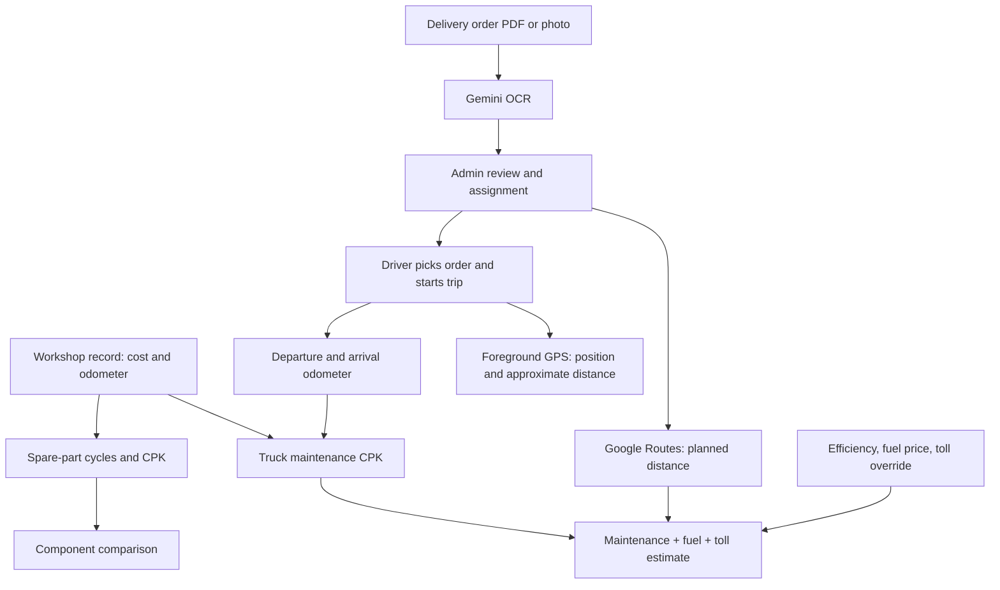

# KiloMetric — Modules, Data and Formulas

> Updated 16 October 2026. Written from the project code as it exists. This document describes the current implementation; future features are marked as planned. Product direction and the roadmap are in [Product Direction and Development](PRODUCT_DIRECTION.md), and how to run the application is in [README.md](README.md).

## Table of contents

1. [System overview and separation of numbers](#1-system-overview-and-separation-of-numbers)
2. [Application modules](#2-application-modules)
3. [Data and relationships between modules](#3-data-and-relationships-between-modules)
4. [Maintenance, truck and fleet formulas](#4-maintenance-truck-and-fleet-formulas)
5. [Spare-part lifespan and CPK formulas](#5-spare-part-lifespan-and-cpk-formulas)
6. [Mix optimizer formulas](#6-mix-optimizer-formulas)
7. [Delivery order estimate formulas](#7-delivery-order-estimate-formulas)
8. [Trip, load and GPS formulas](#8-trip-load-and-gps-formulas)
9. [When numbers change and when they are frozen](#9-when-numbers-change-and-when-they-are-frozen)
10. [Validation, limits and failure conditions](#10-validation-limits-and-failure-conditions)
11. [End-to-end example from workshop to delivery](#11-end-to-end-example-from-workshop-to-delivery)
12. [Code map and API contract](#12-code-map-and-api-contract)
13. [Rounding, interpretation and verification](#13-rounding-interpretation-and-verification)
14. [Features not yet calculated](#14-features-not-yet-calculated)

## 1. System overview and separation of numbers

KiloMetric has two main flows. First, workshop records produce actual maintenance cost, odometer readings and component history. Second, delivery orders produce a delivery plan, a driver assignment, a distance/cost estimate and then the actual trip.



### 1.1 Four kinds of cost number

| Number | Basis | Unit | Meaning |
| --- | --- | --- | --- |
| Truck maintenance CPK | Recorded maintenance spend / odometer distance since baseline | IDR/km | Historical cost intensity of the truck |
| Spare-part CPK | Installation cost / kilometres of life until replaced | IDR/km or IDR/unit/km | Cost of a completed component cycle |
| Order cost estimate | Historical maintenance CPK, Google distance, fuel assumptions and toll | IDR | Projected cost of a delivery plan |
| Order total CPK estimate | Maintenance + fuel + toll estimate, divided by Google distance | IDR/km | Projected cost intensity of the trip |

Maintenance CPK does not become a total operating CPK just because the order module calculates fuel and toll. Order cost estimates are not added to the maintenance table. The application also does not yet record actual fuel/toll spending as an operating cost ledger.

### 1.2 Three distance sources

| Source | Used for | Limits |
| --- | --- | --- |
| Google Maps Routes | Planned distance from pickup → all stops | A driving estimate, not road verification for trucks |
| Vehicle odometer | Distance since baseline and distance of a completed trip | Must be reported correctly by staff/driver |
| Phone GPS points | Latest position and approximate distance moved | Can drop out and contains noise; does not replace the odometer |

The GPS point at trip start is the driver's position at departure. The order pickup is the planned address reviewed by the admin. If the two differ, the order estimate does not automatically add the distance from the GPS location to the pickup.

## 2. Application modules

### 2.1 Login and People & access

**Purpose:** decide who uses the application and what actions they may take.

**Input:** email/password at login; the admin manages name, email, role, active status, password and the list of trucks assigned to a driver.

**Process:** the backend checks the password hash, creates a session and authorises every API call. Passwords are not stored as plain text. Accounts that are deactivated or updated lose their earlier sessions. The last active admin cannot be removed.

**Output:** the user's identity and the data their access rights allow. This module has no cost formulas.

| Capability | Admin | Manager | Workshop | Driver |
| --- | --- | --- | --- | --- |
| Manage trucks, catalog, maintenance | Yes | Yes | Yes | No |
| View trips | All | All | No | Own only |
| Write trips/GPS | No | No | No | Own only |
| Trigger manual Gemini maintenance analysis | Yes | Yes | No | No |
| Manage accounts/truck assignments | Yes | No | No | No |
| Upload OCR, review, assign orders | Yes | No | No | No |
| Read orders | All | No | No | Own only |

A driver receives their assigned trucks, the compatible catalog and the maintenance records for those trucks. OCR source metadata and the identity of an order's creator/reviewer are filtered out of driver data. The Manager role does not yet work as a delivery order dispatcher; order assignment is still Admin-only.

**Limits:** server sessions are held in memory, last at most 12 hours and end when the server restarts. There is no self-registration, self-service password reset, SSO, 2FA or full audit trail yet. The old demo credentials were kept after the rename to KiloMetric; see the README.

### 2.2 Overview / dashboard

**Purpose:** show fleet cost, distance and condition from the stored records.

**Input:** trucks, maintenance, baseline and current odometer.

**Process:** `analytics()` sums cost per truck, calculates tracked distance, builds component cycles and aggregates the fleet numbers.

**Output:** fleet maintenance CPK, maintenance spend, distance tracked, number of trucks, number of completed cycles with positive distance, a CPK chart per truck and the latest maintenance.

**Formulas:** sections 4 and 5. The chart sorts CPK from high to low. Bar length is only a visual comparison against the highest CPK shown; it is not a savings percentage or a confidence score.

**Limits:** the numbers depend on how complete the transactions are. A driver's CPK, when requested through filtered data, is calculated from the trucks visible to them, not automatically from the whole company.

### 2.3 Fleet & trucks

**Purpose:** store the identity and tracking period of every vehicle.

**Input:** plate, model, operating profile, baseline date/odometer, current odometer, and declared specifications if they were ever saved during a trip.

**Output:** distance since baseline, total maintenance, CPK and number of visits.

There are two baseline modes. A truck registered from a workshop visit uses an automatic baseline from its earliest visit. A truck previously registered manually keeps its manual baseline. A separately reported odometer is stored in `reportedOdometer` so that workshop corrections do not erase trip readings.

**Limits:** specifications are declarations and are not yet tied to a manufacturer catalog or official documents. Editing the master model/profile can change how history is grouped in analysis, because per-transaction classification snapshots are not available yet. A truck referenced by maintenance, trips or orders cannot be deleted directly.

### 2.4 Maintenance / workshop check-in

**Purpose:** one work record becomes the source of cost and component changes.

**Input:** the vehicle or new vehicle data, date, odometer, workshop, notes, spare-part lines, actual price, quantity, position, installation cost, general labour and other charges.

**Process:** validate compatibility and chronology, save truck + visit atomically for a new registration, sync the odometer, then recalculate CPK and cycles. The form preview simulates the result on a copy of the data before saving; the preview is not a saved transaction.

**Output:** the maintenance visit, total cost, latest baseline/odometer and derived component cycles.

**Formulas:** sections 4.1–4.4 and 5.1–5.2.

**Limits:** the catalog price is only a default. The actual price is stored on the visit line. Installation cost is the line's total cost and is not multiplied by quantity again. Do not enter it a second time as general labour.

### 2.5 Spare parts & CPK

**Purpose:** keep the product catalog separate from the physical usage history.

**Catalog input:** name, brand, category, SKU, compatible models, default price.

**Analysis input:** installations and replacements in maintenance, plus the truck odometer.

**Output:** observed CPK per unit, average completed lifespan, number of completed records/units, active units, model filter, and installation/replacement details.

The SKU is the product identity. A cycle is one installation of a product on a specific truck and position. The same product can have many cycles on many vehicles.

**Formulas:** section 5. Group CPK and per-unit CPK are different. Old data that recorded a pair of tyres together is not automatically turned into two individual tyre histories.

**Limits:** category + position decide what counts as a replacement. There is no physical serial number, rotation, transfer between trucks, removal without a replacement, repair or retread as a dedicated event sequence yet. The catalog can combine positions and profiles; do not treat its summary as a like-for-like comparison.

### 2.6 Mix optimizer

**Purpose:** find the SKU with the lowest observed group CPK in the same context.

**Input:** completed cycles, model, operating profile, category, position and part ID.

**Process:** take completed cycles with positive kilometres, aggregate each SKU within the same cohort, then sort by CPK. For each category/position the candidate with the lowest CPK is chosen.

**Output:** candidate per category/position, average lifespan, sample count and the number of alternative SKUs compared.

**Formulas:** section 6. The "Limited evidence" label shown when there are fewer than 5 samples is a UI threshold, not a statistical confidence interval. Having 5 or more samples does not prove a definite result.

**Limits:** grouping uses `partId`; it does not merge all SKUs that share a brand name. The UI text "brands compared" currently comes from the number of SKU candidates; the number of unique brands can differ. Quantity is not part of the group key, so group records with different unit counts need review before a purchasing decision. The winning combination has not been tested as one vehicle package.

### 2.7 Gemini insights — maintenance analyst

**Purpose:** explain the calculated results and the comparison evidence in plain language.

**Input sent:** currency, revision, sample-data indicator, total cost/distance/CPK, truck summary, catalog, completed-cycle comparison and number of active cycles.

**Process:** the backend does the calculations first. If a key is available, fleet/maintenance changes and trip start/end can trigger an analysis with a 1.5-second debounce. Manual requests are available to Admin/Manager. The result stores the source revision, time, text and status/error.

**Output:** explanation and data gaps. A Gemini failure does not cancel a workshop transaction.

**Limits:** there is no automatic training/fine-tuning. Delivery order documents, customer lists and GPS points are not included in the current maintenance analyst payload. A new analysis does not automatically become an approval of compatibility or a route.

### 2.8 Delivery orders — upload and Gemini OCR

**Purpose:** turn a PDF/photo of a surat jalan (delivery note) into a draft that can be reviewed.

**Input:** PDF/JPEG/PNG/WebP up to 8 MiB.

**Process:** the server checks the format and leading file signature, encoding, size and duplicate hash; sends the media to Gemini; reads the JSON response; validates the whole list; then saves the drafts. The signature check is not a malware scan and does not guarantee that the whole document is valid.

**Output:** at most 20 drafts per upload, each with 1–10 stops and at most 100 goods lines, plus extraction warnings. Fields include reference, customer, delivery date, pickup, recipient/address/contact per stop, cargo lines, weight and notes.

Gemini is asked to keep the stop order, fill unknowns as empty/null, and convert explicit weights to kg. The backend validates the shape/range of numbers, but it does not prove the OCR matches the facts; admin review is still required. Goods quantity is not automatically multiplied by unit weight, because the current goods structure has no per-unit weight field.

**Limits:** extraction does not assign a driver automatically. Byte-for-byte identical documents are rejected through SHA-256; a retaken photo or a re-saved PDF can have a different hash. The reference number itself is not yet a uniqueness rule that prevents every duplicate order.

The original file is not stored in the database. What is stored is the fields, file name/type, hash, model, time and warnings. A preview of the selected file is available in that browser session. Manual entry is available without a Gemini key.

### 2.9 Delivery orders — review and assignment

**Input:** corrected draft, review confirmation, active driver, truck and cost assumptions.

**Rules:** reference, pickup and every stop address must be filled in before saving the review. Driver and truck must be chosen together or both left empty. The truck must be part of the driver's assignment in People & access. If both order weight and truck specifications are available, the weight is checked against the declared capacity.

**Output:** a reviewed `draft` if not yet assigned, or `assigned` if a driver/truck was chosen. An edit always clears the previous estimate and increments the order version. A review for an old version does not replace the confirmation of a later edit.

```text
Extraction/manual → draft
Review without driver/truck → draft with reviewedAt
Review + driver/truck → assigned
Driver starts linked trip → in_transit
Driver closes linked trip → completed
```

**Limits:** there is no cancelled status, proof of delivery, signature, partial delivery or per-stop status. `completed` means the trip was closed. One order is linked to one trip; merging several orders is not available yet. Several orders can be assigned to the same driver, but they may only run one active trip.

### 2.10 Google Maps — order distance and cost estimate

**Input:** pickup and all reviewed stop addresses, truck ID, loaded fuel efficiency, fuel price and an optional toll override.

**Process:** the frontend requests an estimate after a reviewed order is saved, if a key is available. The server calls Google Routes with `DRIVE`, `TRAFFIC_AWARE`, tolls allowed, fixed stop order and no alternative routes. Distance in metres is converted to km. Partial geocode matches and failed geocode statuses reported by the provider are rejected.

**Output:** distance, driving duration if returned, toll in IDR if available, separate costs, total trip CPK, timestamp, and a snapshot of the maintenance revision/cost assumptions.

**Formulas:** section 7. Gemini does not fill in kilometres and does not calculate financial totals.

**Limits:** this is not stop-order optimisation or truck-safe routing. There is no return leg, cost of driving from the GPS position to the pickup, service time, elevation, or guarantee that the toll class matches a truck. The partial-match check does not prove the address is exactly right. The Google ETA is the duration at request time; it does not use the order's delivery date as a departure schedule.

If the provider fails, the saved order remains; no made-up fallback kilometres are used. The admin can assign without an estimate, with the unknown values visible. A manual refresh updates the snapshot before the trip starts.

### 2.11 Trips & GPS — driver

**Input:** an optional order or a manual destination, an assigned truck, start location, odometer, specifications/load, and confirmation of the externally approved route.

**Process:** validate ownership, one active trip per driver/truck, gross weight, GPS freshness and odometer. A linked order must be assigned to that driver with the same truck. All stops are copied to the trip and the final stop becomes the main destination.

**Output:** the active trip, latest point, cumulative GPS distance, and a maintenance CPK snapshot taken after the departure odometer is updated. The arrival odometer closes the trip, updates the truck mileage and closes the linked order.

**Formulas:** section 8. The maintenance estimate of a completed trip uses actual odometer distance × the CPK snapshot at departure. That differs from the order total estimate, which uses Google distance plus fuel/toll.

**Limits:** the driver still confirms the actual load. If the order has a weight, the trip's declared load may not be lower than that weight. There is no automated per-stop visit or proof that the vehicle actually passed every stop.

### 2.12 PWA and offline status

**Purpose:** let users install the web app and show a status when the connection fails.

**Components:** manifest, icons, install control, production service worker, offline page.

The service worker caches the public offline page/icons/manifest; authentication, order, maintenance and GPS APIs stay network-only. The offline page is not a copy of the full operational application. There is no offline input queue.

GPS needs permission and a secure context. Tracking is currently foreground only; a locked screen or a hidden app can stop updates. An old location must be read together with its timestamp and freshness status.

**Limits:** install and GPS have not yet been tested on real phones as part of this project's validation. Continuous background tracking needs its own architecture decision.

### 2.13 Settings, storage and backup

**Purpose:** view connection status, configuration and the business snapshot.

Keys are stored on the server through `.env`. Gemini OCR can use `GEMINI_OCR_MODEL`; if empty, it uses the maintenance model. Order distance via Maps uses `MAPS_API_KEY` with the Routes API enabled. The truck routing/elevation slot has no adapter yet.

Current storage is `data/fleet.json`, schemaVersion 3, with users/trips/orders added during initialisation/migration. Writes are serialised: clone → change → temporary file → rename → replace in-memory state. An SQL database and multi-instance deployment are not available yet.

The UI export downloads a business snapshot without password hashes, with the latest GPS point in the trip summary. It is not a full recovery backup. A full restore needs a copy of the server file taken while the server is stopped, including accounts and GPS history. In-memory sessions are not restored from the file.

### 2.14 Validation and testing

`lib/validation.js` checks master data/maintenance, `lib/trips.js` checks trips/GPS, and `lib/orders.js` checks documents/orders/costs. `server.js` runs RBAC, transactions and integrations.

19 automated tests in the latest implementation cover business rules and APIs with mock providers. The build and an admin/driver render smoke check also passed. This document does not replace tests with live keys, OCR quality on real documents, results for Indonesian addresses, or browser/phone QA.

## 3. Data and relationships between modules

| Data | Key fields | Relationships |
| --- | --- | --- |
| User | `id`, `role`, `active`, `assignedTruckIds` | A driver may pick trucks within their assignment |
| Truck | `id`, `plate`, `model`, `duty`, `baselineOdometer`, `odometer`, `reportedOdometer` | Many maintenance records, cycles, orders and trips |
| Part | `id`, `sku`, `brand`, `category`, `models`, `price` | Catalog product referenced by maintenance lines |
| Maintenance | `truckId`, `date`, `odometer`, `items`, `labor`, `otherCost` | Source of actual cost and installations |
| Maintenance item | `partId`, `position`, `quantity`, `unitCost`, `labor` | One installation or one group installation |
| Derived cycle | `installationId`, `quantity`, `cost`, start/end odometer, `status` | Recalculated from maintenance; not a permanent physical installation table |
| Order | reference, pickup, `stops`, `items`, `cargoWeightKg`, driver/truck, `version` | Draft/review/assignment and the link to one trip |
| Order estimate | distance, costs, CPK, timestamp, revision | Plan snapshot, not an actual invoice |
| Trip | driver/truck, `orderId`, `deliveryStops`, odometer, specs, points | Trip execution and mileage |
| AI analysis | text, revision, updatedAt, status/error | Explanation from a specific calculation context |

The `labor` field on maintenance is general labour. The `labor` field on each item is the line's installation cost. The field name is the same but the scope is different.

Order `items` are goods being shipped; maintenance `items` are installed spare parts. Cargo quantity does not indicate a number of spare parts or a maintenance cost.

## 4. Maintenance, truck and fleet formulas

Notation: `Σ` means the sum over all elements that match the filter. All costs are in IDR and all odometer readings/distances are in km.

### 4.1 Spare-part line cost

```text
B_i = q_i × p_i + l_i
```

- `q_i`: number of units, an integer of at least 1.
- `p_i`: actual unit price stored on the transaction.
- `l_i`: total installation cost for that line, not per unit.

Example: two tyres × Rp4,000,000 + Rp400,000 installation = **Rp8,400,000**. The calculation is not `2 × (Rp4,000,000 + Rp400,000)`.

### 4.2 Cost of one visit

```text
V_j = Σ B_i + L_j + O_j
```

`L_j` is general labour; `O_j` is other maintenance cost. If spare parts are Rp8,400,000, general labour Rp300,000 and other cost Rp100,000, the visit total = **Rp8,800,000**.

A visit without spare parts can still have labour/other cost. There is no structured tax/discount; the system sums the cost values that were actually entered. Whether invoices include tax must be handled consistently in operations.

### 4.3 Baseline and current odometer

For workshop trucks, visits are sorted by date and then odometer:

```text
Baseline = odometer of the earliest visit still stored
O_current = max(reportedOdometer, baseline, all visit odometers)
```

If no visits remain, the previous workshop baseline is kept; the code does not create a new baseline from missing data. Manual trucks keep their manual baseline.

Example: baseline 100,000, latest workshop 110,000, reported trip odometer 112,000: current = **112,000**. Correcting the latest workshop reading to 109,000 does not erase the reported 112,000.

### 4.4 Truck total and CPK

```text
S_t = Σ V_j for truckId = t
D_t = O_current,t − O_baseline,t
CPK_t = S_t / D_t, if D_t > 0
CPK_t = null, if D_t = 0
```

Example: costs of Rp1,000,000 + Rp1,500,000, baseline 100,000, current 110,000: **Rp250/km**.

The first visit's cost enters the numerator even though the initial distance is zero. When the distance later grows, that cost is still counted. This is cost since tracking began, not a reconstruction of the truck's life since purchase. If distance is positive and recorded cost is zero, the numeric result is 0; that does not prove no cost was ever missed.

### 4.5 Fleet CPK

```text
S_fleet = Σ S_t
D_fleet = Σ D_t
CPK_fleet = S_fleet / D_fleet, if D_fleet > 0
```

Truck A Rp2,000,000 / 10,000 km = Rp200/km. Truck B Rp9,000,000 / 30,000 km = Rp300/km. Fleet = Rp11,000,000 / 40,000 km = **Rp275/km**, not the Rp250/km of a simple mean.

The cost of a truck with zero distance still enters the fleet cost total; its distance adds zero. If all distances are zero, fleet CPK is unknown. The visit count is a count of records, not of spare-part lines.

## 5. Spare-part lifespan and CPK formulas

### 5.1 Finding the start and end of a cycle

For each truck, sort visits by date, odometer, then ID as a tie-break. Use the slot:

```text
slot = catalog category + ':' + trim(lowercase(position))
```

The next installation in the same slot closes the previous installation, even if the part ID or brand differs. The new installation then becomes active. Positions with different translations/spellings are not automatically treated as the same.

### 5.2 Completed cycle

```text
K_c = q_c × p_c + l_c
D_c = replacement odometer − installation odometer
CPK_group,c = K_c / D_c
CPK_unit,c = K_c / (q_c × D_c)
```

The division only applies if `D_c > 0`. If the replacement happens at the same odometer reading, the cycle has status completed but CPK is null and it does not enter rankings/positive averages.

For quantity 1: Rp4,000,000 + Rp200,000, lifespan 60,000 km → **Rp70/km**.

For quantity 2: Rp8,400,000, shared lifespan 60,000 km → **Rp140/km for the group** and **Rp70/unit/km**.

A visit's general labour is not allocated to components. The replacement installation pays for its own new cycle; its cost is not added to the old component's cycle.

### 5.3 Active components

```text
D_so_far = current truck odometer − installation odometer
CPK_group = null
CPK_unit = null
```

The system shows the distance so far, but does not call it the final lifespan. For example, a tyre that has run 20,000 km must not get a final prediction of Rp210/km just from Rp4,200,000 / 20,000 as a completed-lifespan ranking. That value is not an active metric the application currently calculates.

### 5.4 Catalog aggregation per unit

Filter cycles by the selected part ID and the selected model, if any. Take only completed cycles with positive distance:

```text
K_total = Σ K_c
U_km = Σ(q_c × D_c)
U = Σ q_c
CPK_catalog = K_total / U_km
Average_life_catalog = U_km / U
Completed_records = count(completed cycles with D_c > 0)
Completed_units = U
Active_units = Σ q_c of active cycles
```

Example:

| Cycle | Units | Lifespan | Group cost |
| --- | ---: | ---: | ---: |
| A | 1 | 40,000 km | Rp2,000,000 |
| B | 2 | 60,000 km | Rp8,000,000 |

Unit-km = 40,000 + 2 × 60,000 = 160,000. Cost = Rp10,000,000. Catalog CPK = **Rp62.50/unit/km**. Average lifespan = 160,000 / 3 = **53,333.33 km**. Completed records = 2; completed units = 3.

Without positive cycles, CPK and average life are null. The history detail can still show active or zero-distance cycles even though they are not aggregated.

## 6. Mix optimizer formulas

### 6.1 Comparison group

```text
group key = model + duty + category + partId + position
```

For each SKU group:

```text
Cost_g = Σ K_c
Distance_g = Σ D_c
Samples_g = count(c)
CPK_optimizer,g = Cost_g / Distance_g
Average_life_optimizer,g = Distance_g / Samples_g
```

This is the CPK of the installation group's cost per kilometre, not the catalog's per-unit-km division. The optimizer's average life is an average per cycle record, not an average weighted by number of units.

Using the A/B example from section 5.4, if both fall in the same optimizer group:

```text
CPK optimizer = Rp10,000,000 / (40,000 + 60,000) = Rp100/km
Average life optimizer = (40,000 + 60,000) / 2 = 50,000 km
```

The result differs from the catalog's Rp62.50/unit/km and 53,333.33 km because the denominator differs. For a fair assessment, keep the meaning of position and the group unit count consistent; quantity is not yet a grouping dimension in the current code.

### 6.2 Choosing the winner

For the selected model/profile and each category/position:

```text
Winner = the candidate with the smallest CPK_optimizer
```

A candidate at Rp80/km is chosen over one at Rp100/km if they are in the same cohort. If there is only one candidate, there is no comparative evidence. The same brand name on several SKUs is not automatically merged.

There is no validated formula for savings percentage, failure prediction, remaining life or total vehicle mix CPK. Summing the winners does not automatically give a truck CPK, because general labour/other cost is excluded and each component has a different history.

## 7. Delivery order estimate formulas

### 7.1 Distance and duration from Google

```text
D_plan = routes[0].distanceMeters / 1,000
Driving_minutes = durationSeconds / 60
```

The backend takes the first route returned by the provider. It does not calculate the road from haversine and does not compare all alternatives on its own.

Example: pickup Jakarta → Bekasi → Bandung. The first stop is sent as an intermediate, the last stop as the destination. If Google returns 240,000 metres and `14400s`, distance = **240 km** and driving duration = **240 minutes**. This does not yet include loading/unloading and is not a scheduled arrival ETA timestamp.

### 7.2 Projected maintenance

```text
C_maint = CPK_truck_at_estimate × D_plan
```

The CPK is taken from the selected truck's analytics when the estimate is made. Without a truck ID or positive historical distance, the maintenance CPK and the maintenance cost estimate are null.

### 7.3 Projected fuel

```text
Liters = D_plan / Efficiency_km_per_liter
C_fuel = Liters × Fuel_price_IDR_per_liter
```

Efficiency and price come from the admin; Gemini guesses neither. Entered values must be positive. If efficiency is empty, litres and cost are unknown. If price is empty but efficiency is set, litres can be calculated but cost stays unknown.

Example: 240 / 4 = 60 litres; 60 × Rp10,000 = **Rp600,000**. This model uses a fixed efficiency for the whole plan; it does not yet distinguish load before/after a drop, gradients, traffic or idle time.

### 7.4 Projected toll

Google prices in the Money representation are converted:

```text
Price_IDR = Number(units) + Number(nanos) / 1,000,000,000
Google_toll_IDR = Σ Price_IDR over a list whose currencyCode values are all IDR
```

An empty/unavailable list, mixed or non-IDR currencies, or invalid values give unknown. There is no currency conversion.

Source priority:

```text
If tollOverrideIdr is not null → use the admin override
Otherwise, if Google toll IDR is available → use Google
Otherwise → null
```

An override of **0** is valid and must be used; zero is not the same as empty. Google's driving toll still needs to be checked against the truck class. An unavailable toll price is not proof that the route is toll-free.

### 7.5 Total and total trip CPK

```text
C_total = C_maint + C_fuel + C_toll
CPK_total_plan = C_total / D_plan
```

Both are calculated only if all three cost components are known and the Google distance is positive. The cost parts that are available are still shown even when the total is unknown. Driver wages, depreciation, special taxes, margin or unloading costs are not added automatically.

Example:

| Component | Calculation | Result |
| --- | --- | ---: |
| Maintenance | Rp250/km × 240 km | Rp60,000 |
| Fuel | 240 km / 4 km/l × Rp10,000/l | Rp600,000 |
| Toll | Admin override | Rp150,000 |
| Total | 60,000 + 600,000 + 150,000 | Rp810,000 |
| Total CPK | 810,000 / 240 | Rp3,375/km |

The total CPK of Rp3,375/km is an estimate for operating the order. The maintenance CPK snapshot stays Rp250/km. No Rp810,000 maintenance journal entry is created from the estimate.

## 8. Trip, load and GPS formulas

### 8.1 Weight and capacity

```text
Gross_kg = Tare_kg + Load_kg
Departure condition: Gross_kg ≤ Max_gross_kg
If the order has cargoWeightKg: Load_kg ≥ Cargo_weight_order
```

Example: tare weight 8,000 kg + load 4,000 = **12,000 kg**. With a declared maximum of 20,000, it passes the gross weight check. A load of 13,000 gives 21,000 and is rejected.

This does not calculate per-axle load distribution, ground pressure or verification against manufacturer limits. The number of axles is stored but is not used as a divisor to state the load on each axle.

### 8.2 Trip odometer distance

```text
D_trip_actual = O_arrival − O_departure
O_departure ≥ O_current at start
O_arrival ≥ max(O_departure, O_current at completion)
```

The departure odometer is stored as reported mileage, and analytics are recalculated **before** `maintenanceCpkAtStart` is taken. So the snapshot uses a historical distance that already includes the departure reading.

```text
C_maint_trip_estimate = maintenanceCpkAtStart × D_trip_actual
```

If the CPK snapshot is null, the trip cost is also null. A trip distance of zero is valid and gives an estimated cost of 0 when the snapshot is known. The system does not use Google distance to replace the arrival odometer.

### 8.3 Haversine for GPS distance

For the latitude/longitude of two points, convert degrees to radians:

```text
rad(x) = x × π / 180
Δφ = rad(latitude_2 − latitude_1)
Δλ = rad(longitude_2 − longitude_1)
φ1 = rad(latitude_1)
φ2 = rad(latitude_2)
a = sin²(Δφ/2) + cos(φ1) × cos(φ2) × sin²(Δλ/2)
d_km = 6,371 × 2 × atan2(√a, √max(0, 1 − a))
```

The number **6,371** here is the Earth's radius of **6,371 kilometres (six thousand three hundred seventy-one)**; the JavaScript code writes it as `6371`. This is the distance over a sphere's surface between consecutive points, not a road route distance.

### 8.4 Speed validation and noise filter

```text
Δt_seconds = (timestamp_2 − timestamp_1) / 1,000
v_km_per_hour = d_km / Δt_seconds × 3,600
```

Points whose timestamp does not increase are ignored before the division. Movement faster than 160 km/h is rejected as implausible. The value 160 is a GPS data validation threshold, not a recommended driving speed limit.

For samples that pass:

```text
Noise_threshold_m = max(10, (accuracy_1 + accuracy_2) / 2)
If d_km × 1,000 > Noise_threshold_m:
    gpsDistanceKm += d_km
Otherwise:
    do not add distance
```

Valid samples are still added to the points list even when the distance does not grow because of noise. For example, a distance of 8 m with a 10 m threshold is not counted; a distance of 50 m with a 20 m threshold counts as 0.05 km if the timestamp/speed rules also pass.

### 8.5 Location freshness and storage limits

```text
GPS_age_ms = now − timestamp
Start location is fresh if GPS_age_ms ≤ 120,000
Timestamp ≤ now + 15,000
Accuracy is within 0–100 metres
```

Latitude must be −90..90 and longitude −180..180. Numerically the timestamp is between 0 and now + 15,000 ms, but a timestamp that is too old still fails the fresh-origin rule or the trip start time rule. For trip batches, points may not be earlier than startedAt minus 120,000 ms. The 120-second freshness rule is required for the origin; later uploads do not use the same freshness check.

The frontend sends at most about once every 5 seconds while online and when no location request is in progress. The backend accepts 1–50 points per batch. At most the 10,000 latest points are stored; cumulative distance already added is not reduced when old points are dropped.

The UI marks a location older than 120 seconds as stale. A stale sample must not be read as a live position just because the coordinates are still shown.

## 9. When numbers change and when they are frozen

| Event | Effect |
| --- | --- |
| Add/edit/delete maintenance | Truck cost, workshop baseline where relevant, CPK, cycles and rankings are recalculated |
| Change catalog price | The new default changes; old actual unitCost stays |
| Change part category/model/truck profile | Can change cohorts or how old cycles match, because classification snapshots do not exist yet |
| Report a higher odometer without cost | Truck denominator grows; numerator stays |
| OCR upload/create order | New draft, no new maintenance cost |
| Review/edit order | Version number increments; previous estimate is cleared |
| Google estimate finishes | Distance/cost/revision snapshot is saved; order version increments |
| Order changed while Google is processing | The result of the old-version request is rejected |
| Start trip | Mileage reported, departure CPK snapshotted, linked order in_transit |
| GPS upload | GPS points/distance grow; odometer CPK does not change from GPS alone |
| Complete trip | Truck mileage and CPK updated; trip maintenance estimate calculated; order completed |

An order estimate is a snapshot. Maintenance/mileage changes do not automatically replace a saved order estimate; the UI shows that the revision differs and the admin can refresh before the start. Once in_transit/completed, the order and estimate cannot be edited through this flow.

`db.revision` marks fleet/maintenance changes and trip start/complete; `order.version` marks mutations of a single order. GPS uploads do not increment the maintenance revision. Order changes do not send order data to the maintenance AI.

## 10. Validation, limits and failure conditions

### 10.1 Summary of input limits

| Data | Current rule |
| --- | --- |
| Maintenance | At most 40 lines; quantity integer ≥1; costs non-negative; unitCost positive |
| Maintenance/baseline date | Valid YYYY-MM-DD, not in the future |
| Odometer chronology | Must not decrease along visit dates |
| Duplicate visit | Same truck + same date + same odometer must be merged |
| Maintenance slot | The same category/position may not appear twice in one visit |
| Part compatibility | The truck model must be in the catalog's models |
| Order upload | At most 8 MiB = 8,388,608 bytes; PDF/JPEG/PNG/WebP |
| Result of one extraction | 1–20 usable orders, each with 1–10 stops, ≤100 cargo lines |
| Delivery date | Valid YYYY-MM-DD if filled in; may be in the future |
| Order cargo | Unknown or 0–200,000 kg |
| Fuel efficiency | Unknown or positive up to 100 km/litre |
| Fuel price | Unknown or positive up to Rp1,000,000/litre |
| Toll override | Unknown or 0 to 1e12 IDR |
| Declared dimensions | Height/width 0.5–10 m, length 1–50 m |
| Axles | Integer 2–20 |
| Tare/maximum weight | Tare 500–200,000 kg; maxGross 500–250,000 kg |
| Trip load | 0–200,000 kg and must not overload |

Validation ranges are technical input limits, not a certification that a vehicle with all values inside those ranges can use a given road.

### 10.2 Unknown, zero and error

- **Unknown/null:** not enough data to calculate. The UI uses Unknown, a dash or Not enough history, depending on the module.
- **Zero:** the value is known to be zero. A toll override of 0 differs from empty.
- **Invalid:** input of the wrong type, negative, out of range or inconsistent; rejected.
- **Provider error:** the order stays saved if the save already succeeded; no new estimate is made from a guess.
- **AI stale:** the old text does not yet reflect the latest revision; it is not a basis for new calculations.

If one component's CPK is unknown, do not replace it with 0 to show a cheap order total. If the Google distance is zero/missing, the estimate request is rejected, so total CPK is never divided by zero.

### 10.3 Request limits and timeouts

OCR: at most two concurrent requests and ten starts per admin per minute. Request timeouts are 60 seconds for Gemini OCR, 30 seconds for Google distance and 45 seconds for maintenance Gemini. Login is limited to 15 attempts per IP per minute.

These values control the local application, not the provider account's quota or cost. There is no unlimited repeated auto-retry. The user can try again after reviewing the error, key, quota or address.

## 11. End-to-end example from workshop to delivery

All numbers below are illustrative, not company data.

### Step A — Start tracking

Truck T-01 enters the workshop at 100,000 km. Cost Rp1,000,000. Baseline = 100,000. Distance = 0. Spend = Rp1,000,000. CPK is not yet known.

### Step B — Second visit

A visit at 110,000 km adds Rp1,500,000. Spend Rp2,500,000, distance 10,000, CPK **Rp250/km**.

### Step C — Admin creates an order

Gemini reads the surat jalan into a pickup and two stops. The admin checks the details, assigns T-01 and an eligible driver, and enters an efficiency of 4 km/l, a price of Rp10,000/l and a toll of Rp150,000. Google gives a distance of 240 km.

Order snapshot: maintenance Rp60,000, fuel Rp600,000, toll Rp150,000, total **Rp810,000**, total CPK **Rp3,375/km**.

### Step D — Driver starts

The driver logs in, picks the order, takes a GPS fix, and confirms specifications/load and route approval. Departure odometer 110,000. The trip's maintenance CPK snapshot stays **Rp250/km**. The order becomes in_transit.

If the driver departed at 110,100 km, the departure CPK would be recalculated to Rp2,500,000 / 10,100 ≈ Rp247.52/km, instead of keeping the Rp250 from the old reading.

### Step E — Driver arrives

In the main example, departure is 110,000 and arrival 110,250. Trip odometer distance = **250 km**. GPS might record 243 km because of route/sampling variation; Google earlier gave 240 km. All three numbers stay separate.

Maintenance estimate of the completed trip = Rp250 × 250 = **Rp62,500**. This is not the actual fuel/toll total. The order is completed; the Rp810,000 dispatch estimate stays stored as a snapshot.

### Step F — Truck CPK after the trip

Spend stays Rp2,500,000 because there is no new workshop transaction. Distance since baseline is now 110,250 − 100,000 = 10,250 km. Current CPK = **Rp243.90/km** to about two decimals.

The numerator does not get Rp62,500 or Rp810,000 added. If they were added, estimates and real maintenance spending would be counted twice.

### Step G — Spare-part assessment

A quantity-1 tyre installed at 100,000 km for Rp4,200,000 including installation is still active at 110,250 km: distance so far 10,250, final CPK unknown. If it is later replaced at 160,000, the final lifespan is 60,000 and CPK **Rp70/km**.

This tyre example is kept separate from the A/B example invoice amounts so that its cost breakdown does not look as if it were already included in the Rp2,500,000 above. In real data, the tyre installation cost must be part of a visit and counts toward the truck's total maintenance.

## 12. Code map and API contract

### 12.1 Main source of each calculation

| File/function | Calculation or responsibility |
| --- | --- |
| [analytics.js](lib/analytics.js) `eventCost` | Line and visit totals |
| [analytics.js](lib/analytics.js) `analytics` | Truck/fleet CPK, cycle matching, optimizer groups |
| [analytics.js](lib/analytics.js) `summarizePartCycles` | Catalog CPK per unit-km and unit-weighted lifespan |
| [workshop.js](lib/workshop.js) `syncWorkshopMileage` | Workshop baseline and max odometer |
| [workshop.js](lib/workshop.js) `previewWorkshopVisit` | Form simulation without writing data |
| [trips.js](lib/trips.js) `truckSpecifications` | Gross weight and overload |
| [trips.js](lib/trips.js) `haversine`, `addLocations` | GPS distance, speed/noise/timestamp |
| [trips.js](lib/trips.js) `completeTrip` | Odometer distance and trip maintenance estimate |
| [orders.js](lib/orders.js) `extractOrders`, `documentInput` | Media, structured OCR, hash and validation |
| [orders.js](lib/orders.js) `newOrder`, `reviseOrder` | Draft, review, assignment, version and estimate reset |
| [orders.js](lib/orders.js) `googleOrderRoute` | Google request and distance/duration/Money conversion |
| [orders.js](lib/orders.js) `estimateCosts` | Projected maintenance, fuel, toll, total and CPK |
| [orders.js](lib/orders.js) `attachOrderToTrip`, `completeOrderForTrip` | Order–trip link and status |
| [auth.js](lib/auth.js) | Accounts, sessions, roles and data filtering |
| [validation.js](lib/validation.js) | Normalisation/validation of master data and maintenance |
| [server.js](server.js) | API RBAC, transactions, start CPK snapshot, revisions, AI integration |
| [seed.js](lib/seed.js) | Initial illustrative data, not a predictive cost model |
| [main.jsx](src/main.jsx) | Dashboard, CRUD, catalog, optimizer, settings and navigation |
| [orders.jsx](src/orders.jsx) | Admin upload, review, assignment, cost breakdown |
| [driver.jsx](src/driver.jsx) | Login, people, pre-trip, GPS, order handoff and trip history |
| [sw.js](public/sw.js) | Offline fallback for public assets |

### 12.2 APIs used between modules

| Method / path | Purpose |
| --- | --- |
| GET `/api/session` | Session identity; can return a null user |
| POST `/api/login`, `/api/logout` | Start/end a session |
| GET `/api/state` | Filtered data, analytics, integration status |
| GET/POST `/api/users`, PUT `/api/users/:id` | Admin reads/creates/updates accounts |
| POST `/api/trucks`, `/api/parts`, `/api/maintenance` | Create records according to role |
| PUT/DELETE `/api/{trucks,parts,maintenance}/:id` | Update/delete with reference validation |
| POST `/api/analyze` | Admin/Manager requests maintenance AI |
| GET `/api/orders` | Admin: all orders; Driver: own orders |
| POST `/api/orders/extract` | Admin: name, MIME, base64 → OCR draft |
| POST `/api/orders` | Admin: order fields → manual draft |
| PUT `/api/orders/:id` | Admin: review/assignment/assumptions, with the current version |
| POST `/api/orders/:id/estimate` | Admin: version → Google distance and cost snapshot |
| POST `/api/trips` | Driver starts a trip, orderId optional |
| GET `/api/trips/:id` | A specific trip, subject to permissions |
| POST `/api/trips/:id/locations` | Owning driver sends points |
| POST `/api/trips/:id/complete` | Owning driver sends the arrival odometer |
| POST `/api/routes/preview` | Truck routing placeholder; valid input still returns unavailable/503 |

The short trip list comes from `/api/state`; GET `/api/trips` is not an implemented list endpoint. For details of every payload/response, check the handlers and API tests. Real keys must never be put into a frontend payload or the documentation.

## 13. Rounding, interpretation and verification

The backend uses JavaScript Number for calculations. Currency display is rounded to whole rupiah; catalog/dashboard CPK is generally shown with at most two decimals. Money display in the trip/order modules can also round CPK to whole rupiah. The sum of rounded display values can differ slightly from the total calculated before formatting.

Do not use rounded UI numbers as input for further calculations. For reconciliation, use the stored numeric values/API results. The implementation does not yet use a decimal accounting library or special financial ledger rounding rules.

### How to trace a number

1. Truck CPK: find the truckId → all visits → sum of `eventCost` → current/baseline → division.
2. Spare-part CPK: find the installation → confirm the slot → find the next replacement → lifespan → cycle cost → decide group or per unit.
3. Catalog: match partId/model → positive completed only → sum of cost and unit-km.
4. Optimizer: match the full cohort key → positive completed only → sum of cost and cycle-km.
5. Order: check timestamp/version → addresses of all stops → Google distance → CPK snapshot → fuel inputs → toll source → total.
6. Trip: check start/end odometer and the start CPK snapshot → calculate the maintenance estimate; compare GPS separately.

This document was checked against the code, and its numeric examples can be reproduced with the backend functions. Documentation-only changes do not need new runtime tests; changes to a formula's implementation must update tests and documentation together.

## 14. Features not yet calculated

There is no production formula yet for the effect of uphill/downhill gradients, remaining component life, failure probability, best-mix interaction, telematics fuel, per-axle load, driver wages, depreciation, order margin or automatic return trips.

The planned terrain grade is `elevation change / horizontal distance × 100%`, but it is not used in the current CPK. There is no automatic uphill/downhill cost multiplier. Before it can be used, elevation data along the road and an empirical model must be available.

Gemini's current role is to read documents and explain maintenance results; Google calculates driving distance; the backend calculates costs and checks access rights. AI recommendation text does not replace source numbers, human review, or provider capabilities that are not yet connected.
