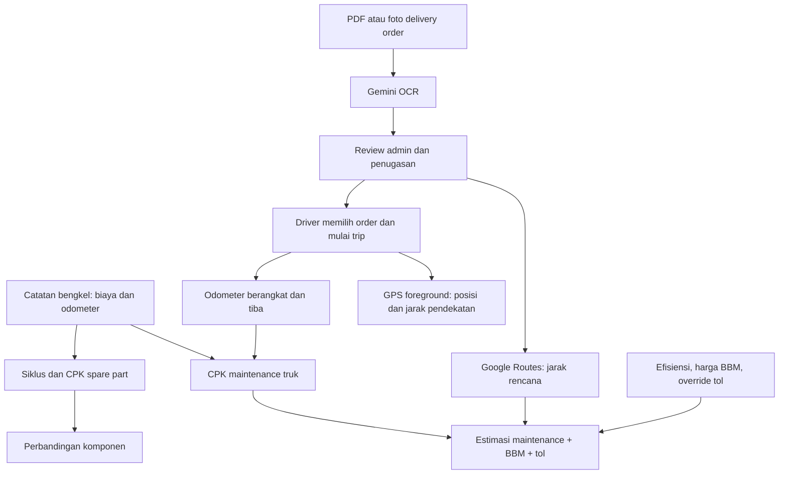

# KiloMetric — Panduan Modul, Data, dan Rumus

> Diperbarui 16 Oktober 2026. Disusun berdasarkan kode proyek yang tersedia. Dokumen ini menjelaskan implementasi saat ini; fitur masa depan ditandai sebagai rencana. Arah produk dan roadmap berada di [ARAH_PENGEMBANGAN.md](ARAH_PENGEMBANGAN.md), sedangkan cara menjalankan aplikasi ada di [README.md](README.md).

## Daftar isi

1. [Gambaran sistem dan pemisahan angka](#1-gambaran-sistem-dan-pemisahan-angka)
2. [Modul aplikasi](#2-modul-aplikasi)
3. [Data dan hubungan antar-modul](#3-data-dan-hubungan-antar-modul)
4. [Rumus maintenance, truk, dan armada](#4-rumus-maintenance-truk-dan-armada)
5. [Rumus umur dan CPK spare part](#5-rumus-umur-dan-cpk-spare-part)
6. [Rumus Mix optimizer](#6-rumus-mix-optimizer)
7. [Rumus estimasi delivery order](#7-rumus-estimasi-delivery-order)
8. [Rumus trip, muatan, dan GPS](#8-rumus-trip-muatan-dan-gps)
9. [Kapan angka berubah dan kapan dibekukan](#9-kapan-angka-berubah-dan-kapan-dibekukan)
10. [Validasi, batas, dan kondisi gagal](#10-validasi-batas-dan-kondisi-gagal)
11. [Contoh terpadu dari bengkel sampai delivery](#11-contoh-terpadu-dari-bengkel-sampai-delivery)
12. [Peta kode dan kontrak API](#12-peta-kode-dan-kontrak-api)
13. [Pembulatan, interpretasi, dan verifikasi](#13-pembulatan-interpretasi-dan-verifikasi)
14. [Fitur yang belum dihitung](#14-fitur-yang-belum-dihitung)

## 1. Gambaran sistem dan pemisahan angka

KiloMetric mempunyai dua alur utama. Pertama, catatan bengkel membentuk biaya maintenance aktual, odometer, dan riwayat komponen. Kedua, delivery order membentuk rencana pengiriman, penugasan driver, estimasi jarak/biaya, lalu perjalanan aktual.



### 1.1 Empat jenis angka biaya

| Angka | Dasar | Satuan | Arti |
| --- | --- | --- | --- |
| CPK maintenance truk | Pengeluaran maintenance tercatat / jarak odometer sejak baseline | IDR/km | Intensitas biaya historis truk |
| CPK spare part | Biaya pemasangan / umur kilometer sampai diganti | IDR/km atau IDR/unit/km | Biaya siklus komponen yang sudah selesai |
| Estimasi biaya order | CPK maintenance historis, jarak Google, asumsi BBM, dan tol | IDR | Proyeksi biaya untuk rencana pengiriman |
| Estimasi total CPK order | Estimasi maintenance + BBM + tol, dibagi jarak Google | IDR/km | Intensitas biaya proyeksi perjalanan |

CPK maintenance tidak berubah menjadi total operating CPK hanya karena modul order menghitung BBM dan tol. Biaya estimasi order tidak dimasukkan ke tabel maintenance. Saat ini aplikasi juga belum mencatat pengeluaran BBM/tol aktual sebagai buku biaya operasional.

### 1.2 Tiga sumber jarak

| Sumber | Digunakan untuk | Batas |
| --- | --- | --- |
| Google Maps Routes | Jarak rencana pickup → seluruh stop | Driving estimate, bukan verifikasi jalan untuk truk |
| Odometer kendaraan | Jarak sejak baseline dan jarak trip selesai | Harus dilaporkan staf/driver dengan benar |
| Titik GPS ponsel | Posisi terakhir dan pendekatan jarak gerakan | Dapat terputus dan mengandung noise; tidak menggantikan odometer |

Titik GPS awal trip adalah posisi pengemudi saat keberangkatan. Pickup order adalah alamat rencana yang ditinjau admin. Jika keduanya berbeda, estimasi order tidak otomatis menghitung tambahan jarak dari lokasi GPS ke pickup.

## 2. Modul aplikasi

### 2.1 Login dan People & access

**Tujuan:** menentukan siapa yang menggunakan aplikasi dan tindakan yang boleh dilakukan.

**Input:** email/password saat login; admin mengelola nama, email, role, status aktif, password, dan daftar truk yang ditugaskan kepada driver.

**Proses:** backend memeriksa password hash, membuat sesi, dan mengotorisasi setiap API. Password tidak disimpan sebagai teks biasa. Akun yang dinonaktifkan atau diperbarui kehilangan sesi sebelumnya. Admin aktif terakhir tidak boleh dihilangkan.

**Output:** identitas pengguna dan data yang sesuai hak akses. Tidak ada rumus biaya dalam modul ini.

| Kemampuan | Admin | Manager | Workshop | Driver |
| --- | --- | --- | --- | --- |
| Mengelola truk, katalog, maintenance | Ya | Ya | Ya | Tidak |
| Melihat perjalanan | Semua | Semua | Tidak | Milik sendiri |
| Menulis perjalanan/GPS | Tidak | Tidak | Tidak | Milik sendiri |
| Memicu Gemini maintenance manual | Ya | Ya | Tidak | Tidak |
| Mengelola akun/penugasan truk | Ya | Tidak | Tidak | Tidak |
| Upload OCR, review, assign order | Ya | Tidak | Tidak | Tidak |
| Membaca order | Semua | Tidak | Tidak | Milik sendiri |

Driver mendapat truk yang ditugaskan, katalog kompatibel, serta maintenance terkait truk tersebut. Metadata sumber OCR dan identitas pembuat/reviewer order disaring dari data driver. Role Manager belum berfungsi sebagai dispatcher delivery order; penugasan order masih khusus Admin.

**Batas:** sesi server disimpan di memori, berlaku maksimum 12 jam, dan berakhir saat server restart. Belum ada self-registration, reset password mandiri, SSO, 2FA, atau audit trail lengkap. Kredensial demo lama dipertahankan setelah rename KiloMetric; lihat README.

### 2.2 Overview / dashboard

**Tujuan:** menampilkan biaya, jarak, dan kondisi armada dari catatan yang tersimpan.

**Input:** truk, maintenance, baseline, dan odometer terkini.

**Proses:** `analytics()` menjumlahkan biaya per truk, menghitung jarak terpantau, menyusun siklus komponen, dan mengagregasi angka armada.

**Output:** fleet maintenance CPK, maintenance spend, distance tracked, jumlah truk, jumlah siklus selesai dengan jarak positif, grafik CPK tiap truk, dan maintenance terbaru.

**Rumus:** bagian 4 dan 5. Grafik mengurutkan CPK dari tinggi ke rendah. Panjang batang hanya perbandingan visual terhadap maksimum CPK yang ditampilkan; bukan persentase penghematan atau confidence score.

**Batas:** angka bergantung pada kelengkapan transaksi. CPK driver, jika diminta melalui data yang telah disaring, dihitung dari truk yang terlihat baginya, bukan otomatis seluruh perusahaan.

### 2.3 Fleet & trucks

**Tujuan:** menyimpan identitas dan periode pelacakan setiap kendaraan.

**Input:** plat, model, profil operasi, baseline tanggal/odometer, odometer saat ini, dan spesifikasi deklarasi jika pernah disimpan saat trip.

**Output:** jarak sejak baseline, total maintenance, CPK, dan jumlah kunjungan.

Ada dua mode baseline. Truk yang didaftarkan dari kunjungan bengkel menggunakan baseline otomatis dari kunjungan paling awal. Truk yang sebelumnya didaftarkan manual mempertahankan baseline manualnya. Odometer yang dilaporkan terpisah disimpan pada `reportedOdometer` agar koreksi workshop tidak menghapus pembacaan perjalanan.

**Batas:** spesifikasi adalah deklarasi, belum diikat ke katalog pabrikan atau dokumen resmi. Mengedit model/profil master dapat mengubah pengelompokan analisis riwayat karena snapshot klasifikasi per transaksi belum tersedia. Truk yang dirujuk maintenance, trip, atau order tidak bisa langsung dihapus.

### 2.4 Maintenance / workshop check-in

**Tujuan:** satu catatan pekerjaan menjadi sumber biaya dan perubahan komponen.

**Input:** kendaraan atau data kendaraan baru, tanggal, odometer, workshop, catatan, baris spare part, harga aktual, jumlah, posisi, biaya pemasangan, tenaga kerja umum, dan biaya lain.

**Proses:** validasi kompatibilitas dan chronology, simpan truk + kunjungan secara atomik untuk registrasi baru, sinkronkan odometer, lalu hitung ulang CPK dan siklus. Preview form menyimulasikan hasil pada salinan data sebelum penyimpanan; preview bukan transaksi tersimpan.

**Output:** kunjungan maintenance, biaya total, baseline/odometer terbaru, dan siklus komponen turunan.

**Rumus:** bagian 4.1–4.4 dan 5.1–5.2.

**Batas:** harga katalog hanya default. Harga aktual tersimpan di baris kunjungan. Biaya pemasangan adalah biaya total baris dan tidak dikalikan jumlah lagi. Jangan memasukkannya ulang ke tenaga kerja umum.

### 2.5 Spare parts & CPK

**Tujuan:** memisahkan katalog produk dari riwayat pemakaian fisiknya.

**Input katalog:** nama, merek, kategori, SKU, model kompatibel, harga default.

**Input analisis:** pemasangan dan penggantian di maintenance, ditambah odometer truk.

**Output:** observed CPK per unit, rata-rata umur selesai, jumlah record/unit selesai, unit aktif, filter model, dan rincian instalasi/penggantian.

SKU adalah identitas produk. Siklus adalah satu pemasangan produk pada truk dan posisi tertentu. Produk yang sama dapat mempunyai banyak siklus pada banyak kendaraan.

**Rumus:** bagian 5. Ada perbedaan antara CPK kelompok dan CPK per unit. Data lama yang mencatat sepasang ban bersama tidak otomatis berubah menjadi dua riwayat ban individual.

**Batas:** kategori + posisi menentukan penggantian. Belum ada serial fisik, rotasi, pemindahan antartruk, pelepasan tanpa pengganti, reparasi, atau retread sebagai rangkaian kejadian khusus. Katalog dapat menggabungkan posisi dan profil; jangan menganggap ringkasannya sudah merupakan perbandingan setara.

### 2.6 Mix optimizer

**Tujuan:** mencari SKU dengan CPK kelompok teramati rendah untuk konteks yang sama.

**Input:** siklus selesai, model, profil operasi, kategori, posisi, dan part ID.

**Proses:** ambil siklus selesai dengan kilometer positif, agregasi tiap SKU dalam cohort yang sama, lalu urutkan CPK. Untuk tiap kategori/posisi dipilih kandidat dengan CPK terendah.

**Output:** kandidat per kategori/posisi, rata-rata umur, jumlah sampel, dan jumlah alternatif SKU yang dibandingkan.

**Rumus:** bagian 6. Label “Limited evidence” saat sampel kurang dari 5 adalah ambang UI, bukan confidence interval statistik. Lebih dari atau sama dengan 5 belum membuktikan hasil pasti.

**Batas:** grouping menggunakan `partId`, bukan menggabungkan seluruh SKU dengan nama merek sama. Teks UI “brands compared” saat ini berasal dari jumlah kandidat SKU; jumlah merek unik bisa berbeda. Quantity tidak menjadi key kelompok, sehingga catatan kelompok dengan jumlah unit berbeda perlu ditinjau sebelum keputusan pembelian. Kombinasi pemenang belum diuji sebagai satu paket kendaraan.

### 2.7 Gemini insights — analis maintenance

**Tujuan:** menjelaskan hasil hitungan dan bukti perbandingan dalam bahasa yang mudah dipahami.

**Input yang dikirim:** mata uang, revisi, indikator data contoh, total biaya/jarak/CPK, ringkasan truk, katalog, perbandingan siklus selesai, dan jumlah siklus aktif.

**Proses:** hitungan dilakukan backend terlebih dahulu. Jika key tersedia, perubahan fleet/maintenance dan awal/akhir trip dapat memicu analisis dengan debounce 1,5 detik. Permintaan manual tersedia untuk Admin/Manager. Hasil menyimpan revisi sumber, waktu, teks, dan status/error.

**Output:** penjelasan serta kekurangan data. Kegagalan Gemini tidak membatalkan transaksi bengkel.

**Batas:** tidak ada training/fine-tuning otomatis. Dokumen delivery order, daftar customer, dan titik GPS tidak dimasukkan ke payload analis maintenance saat ini. Analisis baru tidak otomatis menjadi persetujuan kompatibilitas atau rute.

### 2.8 Delivery orders — upload dan OCR Gemini

**Tujuan:** mengubah PDF/foto surat jalan menjadi draft yang dapat ditinjau.

**Input:** PDF/JPEG/PNG/WebP maksimum 8 MiB.

**Proses:** server memeriksa format dan signature awal file, encoding, ukuran, serta hash duplikat; mengirim media ke Gemini; membaca respons JSON; memvalidasi seluruh daftar; lalu menyimpan draft. Pemeriksaan signature bukan pemindaian malware atau jaminan seluruh isi dokumen valid.

**Output:** maksimum 20 draft per upload, masing-masing 1–10 stop dan maksimum 100 baris barang, plus peringatan ekstraksi. Field meliputi reference, customer, tanggal delivery, pickup, recipient/alamat/contact tiap stop, cargo lines, berat, dan catatan.

Gemini diminta mempertahankan urutan stop, mengisi unknown sebagai kosong/null, dan mengubah berat eksplisit ke kg. Backend memvalidasi bentuk/rentang angka, tetapi tidak membuktikan OCR sesuai fakta; review admin tetap wajib. Quantity barang tidak otomatis dikalikan berat satuan karena struktur barang saat ini tidak memiliki field berat per unit.

**Batas:** ekstraksi tidak otomatis menugaskan driver. Dokumen yang identik byte-for-byte ditolak lewat SHA-256; foto ulang atau PDF yang disimpan ulang dapat memiliki hash berbeda. Nomor reference sendiri belum menjadi aturan unik yang mencegah semua order ganda.

File asli tidak disimpan di database. Yang disimpan adalah field, nama/tipe file, hash, model, waktu, dan warnings. Preview file terpilih tersedia di sesi browser saat itu. Input manual tersedia tanpa key Gemini.

### 2.9 Delivery orders — review dan penugasan

**Input:** draft yang dikoreksi, konfirmasi review, driver aktif, truk, dan asumsi biaya.

**Aturan:** reference, pickup, dan setiap alamat stop wajib terisi sebelum save review. Driver/truk harus dipilih berpasangan atau sama-sama kosong. Truk harus termasuk penugasan driver di People & access. Jika berat order serta spesifikasi truk tersedia, berat diperiksa terhadap kapasitas deklarasi.

**Output:** `draft` yang telah direview bila belum ditugaskan, atau `assigned` jika driver/truk dipilih. Edit selalu menghapus estimate sebelumnya dan menambah versi order. Review untuk versi lama tidak menggantikan konfirmasi edit berikutnya.

```text
Ekstraksi/manual → draft
Review tanpa driver/truk → draft dengan reviewedAt
Review + driver/truk → assigned
Driver mulai trip terkait → in_transit
Driver menutup trip terkait → completed
```

**Batas:** tidak ada status cancelled, proof of delivery, tanda tangan, partial delivery, atau status setiap stop. `completed` berarti trip ditutup. Satu order terkait satu trip; penggabungan beberapa order belum tersedia. Beberapa order dapat ditugaskan untuk driver yang sama, tetapi ia hanya boleh menjalankan satu trip aktif.

### 2.10 Google Maps — jarak order dan estimasi biaya

**Input:** pickup dan semua alamat stop yang sudah direview, truck ID, efisiensi BBM loaded, harga BBM, dan override tol opsional.

**Proses:** frontend meminta estimate setelah save reviewed order jika key tersedia. Server meminta Google Routes `DRIVE`, `TRAFFIC_AWARE`, tol diperbolehkan, urutan stop tetap, tanpa alternatif rute. Jarak meter diubah ke km. Partial geocode match/status geocode gagal yang dilaporkan provider ditolak.

**Output:** jarak, driving duration jika dikembalikan, tol IDR jika tersedia, biaya terpisah, total trip CPK, timestamp, dan snapshot maintenance revision/asumsi biaya.

**Rumus:** bagian 7. Gemini tidak mengisi kilometer dan tidak menghitung total keuangan.

**Batas:** bukan optimasi urutan stop atau truck-safe routing. Tidak ada return leg, biaya menuju pickup dari GPS, service time, elevasi, atau jaminan kecocokan kelas tol truk. Pemeriksaan partial match tidak membuktikan alamat persis benar. Google ETA adalah duration saat request, tidak menggunakan delivery date order sebagai jadwal keberangkatan.

Jika provider gagal, order yang sudah disimpan tetap ada; tidak ada kilometer fallback rekaan. Admin dapat assign tanpa estimate, dengan nilai unknown yang terlihat. Refresh manual memperbarui snapshot sebelum trip dimulai.

### 2.11 Trips & GPS — pengemudi

**Input:** order opsional atau tujuan manual, truk yang ditugaskan, lokasi awal, odometer, spesifikasi/muatan, dan konfirmasi rute eksternal.

**Proses:** validasi kepemilikan, satu trip aktif per driver/truk, berat total, kesegaran GPS, serta odometer. Order terkait harus assigned kepada driver tersebut dengan truk yang sama. Semua stop disalin ke trip dan final stop menjadi destination utama.

**Output:** trip aktif, titik terbaru, jarak GPS kumulatif, dan snapshot CPK maintenance setelah odometer berangkat diperbarui. Arrival odometer menutup trip, memperbarui mileage truk, serta menutup order terkait.

**Rumus:** bagian 8. Estimasi maintenance trip selesai memakai jarak odometer aktual × CPK snapshot keberangkatan. Itu berbeda dari total estimate order yang memakai jarak Google dan BBM/tol.

**Batas:** driver tetap mengonfirmasi muatan aktual. Jika order punya berat, deklarasi muatan trip tidak boleh lebih kecil dari berat tersebut. Tidak ada otomatisasi kunjungan per-stop atau bukti kendaraan benar-benar melewati seluruh stop.

### 2.12 PWA dan status offline

**Tujuan:** menyediakan pemasangan aplikasi web dan status saat koneksi gagal.

**Komponen:** manifest, ikon, kontrol install, service worker produksi, halaman offline.

Service worker menyimpan halaman offline/ikon/manifest publik; API autentikasi, order, maintenance, dan GPS tetap network-only. Halaman offline bukan salinan aplikasi operasional lengkap. Tidak ada antrean input offline.

GPS membutuhkan izin dan konteks aman. Tracking saat ini foreground; layar terkunci atau aplikasi tersembunyi dapat menghentikan update. Lokasi lama harus dibaca bersama timestamp dan status freshness.

**Batas:** belum ada uji install/GPS pada ponsel nyata dalam validasi proyek ini. Tracking background kontinu perlu keputusan arsitektur tersendiri.

### 2.13 Settings, penyimpanan, dan backup

**Tujuan:** melihat status koneksi, konfigurasi, dan snapshot bisnis.

Key tersimpan di server melalui `.env`. Gemini OCR dapat memakai `GEMINI_OCR_MODEL`; jika kosong, memakai model maintenance. Maps order distance menggunakan `MAPS_API_KEY` dengan Routes API aktif. Slot truck routing/elevasi belum memiliki adapter.

Penyimpanan saat ini `data/fleet.json`, schemaVersion 3, dengan users/trips/orders ditambahkan saat inisialisasi/migrasi. Penulisan diserialisasi: clone → perubahan → file sementara → rename → ganti state memori. Database SQL dan deployment multi-instance belum tersedia.

Export UI mengunduh snapshot bisnis tanpa password hash, dengan titik GPS terakhir pada ringkasan trip. Itu bukan full recovery backup. Pemulihan lengkap memerlukan salinan file server saat server dihentikan, termasuk akun dan riwayat GPS. Sesi di memori tidak ikut pulih dari file.

### 2.14 Validasi dan pengujian

`lib/validation.js` memeriksa master/maintenance, `lib/trips.js` memeriksa trip/GPS, dan `lib/orders.js` memeriksa dokumen/order/biaya. `server.js` menjalankan RBAC, transaksi, dan integrasi.

19 tes otomatis pada implementasi terakhir mencakup aturan bisnis dan API dengan provider mock. Build serta render smoke check admin/driver juga berhasil. Dokumen ini tidak menggantikan tes live key, kualitas OCR dokumen nyata, hasil alamat Indonesia, atau QA browser/ponsel.

## 3. Data dan hubungan antar-modul

| Data | Field penting | Hubungan |
| --- | --- | --- |
| User | `id`, `role`, `active`, `assignedTruckIds` | Driver boleh memilih truk dalam penugasannya |
| Truck | `id`, `plate`, `model`, `duty`, `baselineOdometer`, `odometer`, `reportedOdometer` | Banyak maintenance, siklus, order, dan trip |
| Part | `id`, `sku`, `brand`, `category`, `models`, `price` | Produk katalog yang dirujuk baris maintenance |
| Maintenance | `truckId`, `date`, `odometer`, `items`, `labor`, `otherCost` | Sumber biaya aktual dan pemasangan |
| Maintenance item | `partId`, `position`, `quantity`, `unitCost`, `labor` | Satu pemasangan atau kelompok pemasangan |
| Cycle turunan | `installationId`, `quantity`, `cost`, start/end odometer, `status` | Dihitung ulang dari maintenance; bukan tabel instalasi fisik permanen |
| Order | reference, pickup, `stops`, `items`, `cargoWeightKg`, driver/truck, `version` | Draft/review/assignment dan hubungan satu trip |
| Order estimate | distance, biaya, CPK, timestamp, revision | Snapshot rencana, bukan faktur aktual |
| Trip | driver/truck, `orderId`, `deliveryStops`, odometer, specs, points | Pelaksanaan perjalanan dan mileage |
| AI analysis | text, revision, updatedAt, status/error | Penjelasan dari konteks perhitungan tertentu |

Field `labor` pada maintenance adalah tenaga kerja umum. Field `labor` pada tiap item adalah biaya pemasangan baris. Nama field sama tetapi cakupannya berbeda.

`items` order adalah barang kiriman; `items` maintenance adalah spare part yang dipasang. Cargo quantity tidak menunjukkan jumlah spare part atau biaya perawatan.

## 4. Rumus maintenance, truk, dan armada

Notasi: `Σ` berarti jumlah seluruh elemen yang memenuhi filter. Semua biaya dalam IDR dan semua odometer/jarak dalam km.

### 4.1 Biaya baris spare part

```text
B_i = q_i × p_i + l_i
```

- `q_i`: jumlah unit, bilangan bulat minimum 1.
- `p_i`: harga satuan aktual yang disimpan pada transaksi.
- `l_i`: total biaya pemasangan untuk baris itu, bukan per unit.

Contoh: dua ban × Rp4.000.000 + Rp400.000 pemasangan = **Rp8.400.000**. Perhitungan bukan `2 × (Rp4.000.000 + Rp400.000)`.

### 4.2 Biaya satu kunjungan

```text
V_j = Σ B_i + L_j + O_j
```

`L_j` adalah tenaga kerja umum; `O_j` biaya maintenance lain. Jika spare part Rp8.400.000, tenaga kerja umum Rp300.000, dan biaya lain Rp100.000, total kunjungan = **Rp8.800.000**.

Kunjungan tanpa spare part dapat tetap memiliki biaya labor/other. Tidak ada pajak/diskon terstruktur; sistem menjumlahkan nilai biaya yang benar-benar dimasukkan. Ketentuan apakah faktur termasuk pajak perlu konsisten dalam operasi.

### 4.3 Baseline dan odometer saat ini

Untuk truk workshop, kunjungan diurutkan berdasarkan tanggal lalu odometer:

```text
Baseline = odometer kunjungan paling awal yang masih tersimpan
O_current = max(reportedOdometer, baseline, semua odometer kunjungan)
```

Jika belum ada kunjungan tersisa, baseline workshop sebelumnya tetap dipertahankan; kode tidak membentuk baseline baru dari ketiadaan data. Truk manual mempertahankan baseline manual.

Contoh baseline 100.000, workshop terbaru 110.000, reported odometer trip 112.000: current = **112.000**. Mengoreksi workshop terbaru menjadi 109.000 tidak menghapus reported 112.000.

### 4.4 Total dan CPK truk

```text
S_t = Σ V_j untuk truckId = t
D_t = O_current,t − O_baseline,t
CPK_t = S_t / D_t, jika D_t > 0
CPK_t = null, jika D_t = 0
```

Contoh biaya Rp1.000.000 + Rp1.500.000, baseline 100.000, current 110.000: **Rp250/km**.

Biaya kunjungan pertama masuk numerator meskipun jarak awal nol. Saat jarak kemudian bertambah, biaya itu tetap dihitung. Ini biaya sejak pelacakan, bukan rekonstruksi umur truk sejak pembelian. Jika jarak positif dan biaya tercatat nol, hasil numeriknya 0; itu tidak membuktikan tidak pernah ada biaya yang hilang.

### 4.5 CPK armada

```text
S_fleet = Σ S_t
D_fleet = Σ D_t
CPK_fleet = S_fleet / D_fleet, jika D_fleet > 0
```

Truk A Rp2.000.000 / 10.000 km = Rp200/km. Truk B Rp9.000.000 / 30.000 km = Rp300/km. Armada = Rp11.000.000 / 40.000 km = **Rp275/km**, bukan Rp250/km dari mean sederhana.

Biaya truk berjarak nol tetap masuk total biaya armada; jaraknya menyumbang nol. Jika semua jarak nol, fleet CPK unknown. Jumlah kunjungan adalah count record, bukan jumlah baris spare part.

## 5. Rumus umur dan CPK spare part

### 5.1 Menentukan awal dan akhir siklus

Pada setiap truk, urutkan kunjungan berdasarkan tanggal, odometer, lalu ID untuk tie-break. Gunakan slot:

```text
slot = kategori katalog + ':' + trim(lowercase(posisi))
```

Pemasangan berikutnya pada slot sama menutup pemasangan sebelumnya, walaupun part ID atau merek berbeda. Kemudian pemasangan baru menjadi aktif. Posisi dengan terjemahan/ejaan berbeda tidak otomatis disamakan.

### 5.2 Siklus selesai

```text
K_c = q_c × p_c + l_c
D_c = odometer penggantian − odometer pemasangan
CPK_group,c = K_c / D_c
CPK_unit,c = K_c / (q_c × D_c)
```

Rumus pembagian hanya berlaku jika `D_c > 0`. Jika penggantian pada odometer sama, siklus berstatus completed tetapi CPK null dan tidak masuk ranking/average positif.

Untuk quantity 1: Rp4.000.000 + Rp200.000, umur 60.000 km → **Rp70/km**.

Untuk quantity 2: Rp8.400.000, umur bersama 60.000 km → **Rp140/km kelompok** dan **Rp70/unit/km**.

Tenaga kerja umum kunjungan tidak dialokasikan ke komponen. Pemasangan pengganti membayar siklus barunya sendiri; biayanya tidak ditambahkan ke siklus komponen lama.

### 5.3 Komponen aktif

```text
D_so_far = odometer truk sekarang − odometer pemasangan
CPK_group = null
CPK_unit = null
```

Sistem menampilkan jarak sampai sekarang, tetapi tidak menyebutnya umur akhir. Contoh ban telah berjalan 20.000 km tidak boleh diberi prediksi final Rp210/km hanya dari Rp4.200.000 / 20.000 sebagai ranking umur selesai. Nilai tersebut bukan metrik aktif yang dihitung aplikasi saat ini.

### 5.4 Agregasi katalog per unit

Filter siklus dengan part ID terpilih dan model terpilih jika ada. Ambil hanya completed dengan jarak positif:

```text
K_total = Σ K_c
U_km = Σ(q_c × D_c)
U = Σ q_c
CPK_catalog = K_total / U_km
Average_life_catalog = U_km / U
Completed_records = count(siklus completed dengan D_c > 0)
Completed_units = U
Active_units = Σ q_c dari siklus active
```

Contoh:

| Siklus | Unit | Umur | Biaya kelompok |
| --- | ---: | ---: | ---: |
| A | 1 | 40.000 km | Rp2.000.000 |
| B | 2 | 60.000 km | Rp8.000.000 |

Unit-km = 40.000 + 2 × 60.000 = 160.000. Biaya = Rp10.000.000. CPK katalog = **Rp62,50/unit/km**. Umur rata-rata = 160.000 / 3 = **53.333,33 km**. Completed records = 2; completed units = 3.

Tanpa siklus positif, CPK dan average life null. Rincian history tetap dapat menunjukkan siklus aktif atau zero-distance meskipun tidak masuk agregasi.

## 6. Rumus Mix optimizer

### 6.1 Kelompok pembanding

```text
group key = model + duty + kategori + partId + posisi
```

Untuk setiap kelompok SKU:

```text
Cost_g = Σ K_c
Distance_g = Σ D_c
Samples_g = count(c)
CPK_optimizer,g = Cost_g / Distance_g
Average_life_optimizer,g = Distance_g / Samples_g
```

Ini CPK biaya kelompok pemasangan per kilometer, bukan pembagian per unit-km katalog. Average life optimizer adalah rata-rata per record siklus, bukan rata-rata berbobot jumlah unit.

Memakai contoh A/B di bagian 5.4 bila keduanya masuk kelompok optimizer sama:

```text
CPK optimizer = Rp10.000.000 / (40.000 + 60.000) = Rp100/km
Average life optimizer = (40.000 + 60.000) / 2 = 50.000 km
```

Hasil berbeda dari Rp62,50/unit/km dan 53.333,33 km katalog karena denominator berbeda. Untuk penilaian yang adil, konsistenkan arti posisi dan jumlah unit kelompok; quantity belum menjadi dimensi grouping pada kode saat ini.

### 6.2 Memilih pemenang

Untuk model/profil terpilih dan setiap kategori/posisi:

```text
Winner = kandidat dengan CPK_optimizer paling kecil
```

Kandidat Rp80/km dipilih atas Rp100/km bila berada pada cohort yang sama. Jika hanya satu kandidat, tidak ada bukti perbandingan alternatif. Nama merek sama pada beberapa SKU tidak otomatis digabungkan.

Tidak ada rumus persentase savings, prediksi failure, umur tersisa, atau total CPK mix kendaraan yang tervalidasi. Menjumlahkan pemenang tidak otomatis menghasilkan CPK truk karena general labor/other tidak termasuk serta riwayat masing-masing komponen berbeda.

## 7. Rumus estimasi delivery order

### 7.1 Jarak dan duration dari Google

```text
D_plan = routes[0].distanceMeters / 1.000
Driving_minutes = durationSeconds / 60
```

Backend mengambil route pertama yang dikembalikan provider. Ia tidak menghitung jalan dari haversine dan tidak membandingkan semua alternatif secara mandiri.

Contoh pickup Jakarta → Bekasi → Bandung. Stop pertama dikirim sebagai intermediate, stop terakhir sebagai destination. Jika Google mengembalikan 240.000 meter dan `14400s`, jarak = **240 km**, driving duration = **240 menit**. Ini belum termasuk bongkar muat dan belum menjadi timestamp ETA arrival terjadwal.

### 7.2 Maintenance proyeksi

```text
C_maint = CPK_truck_at_estimate × D_plan
```

CPK diambil dari analytics truk yang dipilih saat estimate dibuat. Tanpa truck ID atau jarak historis positif, CPK maintenance dan biaya maintenance estimate null.

### 7.3 BBM proyeksi

```text
Liters = D_plan / Efficiency_km_per_liter
C_fuel = Liters × Fuel_price_IDR_per_liter
```

Efisiensi dan harga berasal dari admin; Gemini tidak menebak keduanya. Nilai yang diisi harus positif. Jika efisiensi kosong, liter dan biaya unknown. Jika harga kosong tetapi efisiensi ada, liter dapat dihitung tetapi biaya tetap unknown.

Contoh 240 / 4 = 60 liter; 60 × Rp10.000 = **Rp600.000**. Model ini memakai efisiensi tetap untuk seluruh rencana; belum membedakan beban sebelum/sesudah drop, tanjakan, traffic, atau idle time.

### 7.4 Tol proyeksi

Harga Google dengan representasi Money dikonversi:

```text
Price_IDR = Number(units) + Number(nanos) / 1.000.000.000
Google_toll_IDR = Σ Price_IDR pada daftar yang seluruh currencyCode-nya IDR
```

Daftar kosong/tidak tersedia, mata uang campuran/bukan IDR, atau nilai tidak valid menghasilkan unknown. Tidak ada konversi kurs.

Prioritas sumber:

```text
Jika tollOverrideIdr bukan null → pakai override admin
Selain itu jika Google toll IDR tersedia → pakai Google
Selain itu → null
```

Override **0** sah dan harus dipakai; nol tidak sama dengan kosong. Google driving toll tetap perlu diperiksa terhadap kelas truk. Harga tol tidak tersedia bukan bukti rute bebas tol.

### 7.5 Total dan total trip CPK

```text
C_total = C_maint + C_fuel + C_toll
CPK_total_plan = C_total / D_plan
```

Keduanya dihitung hanya jika ketiga komponen biaya diketahui dan jarak Google positif. Sebagian biaya yang tersedia tetap ditampilkan walau total unknown. Tidak ada penambahan driver wage, depresiasi, pajak khusus, margin, atau biaya bongkar otomatis.

Contoh:

| Komponen | Perhitungan | Hasil |
| --- | --- | ---: |
| Maintenance | Rp250/km × 240 km | Rp60.000 |
| BBM | 240 km / 4 km/l × Rp10.000/l | Rp600.000 |
| Tol | Override admin | Rp150.000 |
| Total | 60.000 + 600.000 + 150.000 | Rp810.000 |
| Total CPK | 810.000 / 240 | Rp3.375/km |

Total CPK Rp3.375/km adalah estimasi operasi order. CPK maintenance snapshot tetap Rp250/km. Tidak ada jurnal maintenance Rp810.000 yang dibuat dari estimate.

## 8. Rumus trip, muatan, dan GPS

### 8.1 Berat dan kapasitas

```text
Gross_kg = Tare_kg + Load_kg
Syarat keberangkatan: Gross_kg ≤ Max_gross_kg
Jika order memiliki cargoWeightKg: Load_kg ≥ Cargo_weight_order
```

Contoh berat kosong 8.000 kg + muatan 4.000 = **12.000 kg**. Dengan maksimum deklarasi 20.000, lolos pemeriksaan berat total. Muatan 13.000 menghasilkan 21.000 dan ditolak.

Ini tidak menghitung distribusi beban per as, tekanan tanah, atau verifikasi batas pabrikan. Jumlah as disimpan tetapi tidak dipakai sebagai divisor untuk menyatakan beban setiap as.

### 8.2 Jarak odometer trip

```text
D_trip_actual = O_arrival − O_departure
O_departure ≥ O_current saat start
O_arrival ≥ max(O_departure, O_current saat complete)
```

Odometer berangkat disimpan sebagai reported mileage dan analytics dihitung ulang **sebelum** `maintenanceCpkAtStart` diambil. Jadi snapshot menggunakan jarak historis yang sudah mencakup pembacaan keberangkatan.

```text
C_maint_trip_estimate = maintenanceCpkAtStart × D_trip_actual
```

Jika snapshot CPK null, biaya trip juga null. Jarak trip nol sah dan menghasilkan biaya estimasi 0 bila snapshot diketahui. Sistem tidak menggunakan Google distance untuk menggantikan arrival odometer.

### 8.3 Haversine untuk jarak GPS

Untuk latitude/longitude dua titik, konversi derajat ke radian:

```text
rad(x) = x × π / 180
Δφ = rad(latitude_2 − latitude_1)
Δλ = rad(longitude_2 − longitude_1)
φ1 = rad(latitude_1)
φ2 = rad(latitude_2)
a = sin²(Δφ/2) + cos(φ1) × cos(φ2) × sin²(Δλ/2)
d_km = 6.371 × 2 × atan2(√a, √max(0, 1 − a))
```

Angka **6.371** di sini adalah radius bumi **6.371 kilometer (enam ribu tiga ratus tujuh puluh satu)**; kode JavaScript menulisnya `6371`. Ini jarak permukaan bola antara titik berurutan, bukan jarak rute jalan.

### 8.4 Validasi kecepatan dan filter noise

```text
Δt_seconds = (timestamp_2 − timestamp_1) / 1.000
v_km_per_hour = d_km / Δt_seconds × 3.600
```

Titik dengan timestamp tidak meningkat diabaikan sebelum pembagian. Gerakan melebihi 160 km/jam ditolak sebagai implausible. Angka 160 adalah ambang validasi data GPS, bukan rekomendasi batas kecepatan berkendara.

Untuk sampel yang lolos:

```text
Noise_threshold_m = max(10, (accuracy_1 + accuracy_2) / 2)
Jika d_km × 1.000 > Noise_threshold_m:
    gpsDistanceKm += d_km
Selain itu:
    tidak menambah jarak
```

Sampel valid tetap ditambahkan ke daftar points meskipun jarak tidak bertambah karena noise. Contoh jarak 8 m dengan threshold 10 m tidak dihitung; jarak 50 m dengan threshold 20 m dihitung 0,05 km jika aturan timestamp/kecepatan juga lolos.

### 8.5 Kesegaran lokasi dan batas penyimpanan

```text
GPS_age_ms = now − timestamp
Lokasi awal fresh jika GPS_age_ms ≤ 120.000
Timestamp ≤ now + 15.000
Accuracy berada pada 0–100 meter
```

Latitude harus −90..90 dan longitude −180..180. Timestamp secara numerik berada pada 0 sampai now + 15.000 ms, tetapi timestamp terlalu lama tetap gagal aturan fresh origin atau aturan waktu awal trip. Untuk batch trip, titik tidak boleh lebih awal dari startedAt dikurangi 120.000 ms. Aturan fresh 120 detik wajib untuk origin; upload berikutnya tidak memakai pemeriksaan fresh yang sama.

Frontend mengirim paling sering sekitar satu kali per 5 detik saat online dan tidak ada request lokasi yang sedang berlangsung. Backend menerima 1–50 titik per batch. Maksimum 10.000 titik terbaru disimpan; jarak kumulatif yang sudah ditambahkan tidak dikurangi saat titik lama dibuang.

UI menandai lokasi lebih tua dari 120 detik sebagai stale. Sampel stale tidak boleh dipahami sebagai posisi live hanya karena koordinat masih tampil.

## 9. Kapan angka berubah dan kapan dibekukan

| Kejadian | Dampak |
| --- | --- |
| Tambah/edit/hapus maintenance | Biaya truk, baseline workshop jika relevan, CPK, siklus dan ranking dihitung ulang |
| Ubah harga katalog | Default baru berubah; actual unitCost lama tetap |
| Ubah kategori part/model/profil truk | Dapat mengubah cohort atau pencocokan siklus lama karena snapshot klasifikasi belum ada |
| Laporkan odometer lebih tinggi tanpa biaya | Denominator truk bertambah; numerator tetap |
| Upload OCR/create order | Draft baru, tanpa biaya maintenance baru |
| Review/edit order | Nomor versi bertambah; estimate sebelumnya dihapus |
| Google estimate selesai | Snapshot jarak/biaya/revision disimpan; versi order bertambah |
| Order diubah ketika Google sedang memproses | Hasil request versi lama ditolak |
| Mulai trip | Mileage dilaporkan, CPK keberangkatan disnapshot, order terkait in_transit |
| Upload GPS | Titik/jarak GPS bertambah; CPK odometer tidak berubah dari GPS saja |
| Complete trip | Mileage dan CPK truk diperbarui; estimasi maintenance trip dihitung; order completed |

Order estimate adalah snapshot. Perubahan maintenance/mileage tidak otomatis mengganti estimate order yang tersimpan; UI memberi indikasi revision berbeda dan admin dapat refresh sebelum start. Setelah in_transit/completed, order dan estimate tidak boleh diedit melalui alur ini.

`db.revision` menandai perubahan fleet/maintenance dan start/complete trip; `order.version` menandai mutasi satu order. Upload GPS tidak meningkatkan maintenance revision. Perubahan order tidak mengirim data order ke maintenance AI.

## 10. Validasi, batas, dan kondisi gagal

### 10.1 Ringkasan batas input

| Data | Aturan saat ini |
| --- | --- |
| Maintenance | Maksimum 40 baris; quantity integer ≥1; biaya non-negatif; unitCost positif |
| Tanggal maintenance/baseline | Valid YYYY-MM-DD, tidak di masa depan |
| Chronology odometer | Tidak boleh turun mengikuti tanggal kunjungan |
| Duplikat kunjungan | Truck sama + tanggal sama + odometer sama harus digabung |
| Slot maintenance | Kategori/posisi sama tidak boleh dua kali pada satu kunjungan |
| Kompatibilitas part | Model truck harus ada dalam models katalog |
| Upload order | Maksimum 8 MiB = 8.388.608 byte; PDF/JPEG/PNG/WebP |
| Hasil satu ekstraksi | 1–20 order usable, tiap order 1–10 stop, ≤100 cargo lines |
| Tanggal delivery | Valid YYYY-MM-DD jika diisi; boleh di masa depan |
| Cargo order | Unknown atau 0–200.000 kg |
| Efisiensi BBM | Unknown atau positif sampai 100 km/liter |
| Harga BBM | Unknown atau positif sampai Rp1.000.000/liter |
| Override tol | Unknown atau 0 sampai 1e12 IDR |
| Dimensi deklarasi | Tinggi/lebar 0,5–10 m, panjang 1–50 m |
| As | Integer 2–20 |
| Berat kosong/maksimum | Tare 500–200.000 kg; maxGross 500–250.000 kg |
| Muatan trip | 0–200.000 kg dan tidak boleh overload |

Rentang validasi adalah pembatas input teknis, bukan sertifikasi bahwa kendaraan dengan semua nilai dalam rentang itu dapat melewati jalan tertentu.

### 10.2 Unknown, nol, dan error

- **Unknown/null:** data belum cukup untuk menghitung. UI menggunakan Unknown, dash, atau Not enough history sesuai modul.
- **Nol:** nilai diketahui sebesar nol. Override tol 0 berbeda dari kosong.
- **Invalid:** input salah tipe, negatif, di luar rentang, atau tidak konsisten; ditolak.
- **Provider error:** order tetap tersimpan jika save sudah berhasil; estimate baru tidak dibuat dari tebakan.
- **AI stale:** teks lama belum mengikuti revision terbaru; bukan dasar hitungan baru.

Jika CPK satu komponen unknown, jangan menggantinya dengan 0 untuk menampilkan total order murah. Jika jarak Google nol/tidak ada, request estimate ditolak, sehingga tidak terjadi pembagian total CPK dengan nol.

### 10.3 Batas request dan timeout

OCR: maksimum dua request bersamaan dan sepuluh starts per admin per menit. Timeout request Gemini OCR 60 detik, Google distance 30 detik, maintenance Gemini 45 detik. Login dibatasi 15 percobaan per IP per menit.

Nilai tersebut mengendalikan aplikasi lokal, bukan kuota atau biaya akun provider. Tidak ada auto-retry berulang tanpa batas. User dapat mencoba ulang setelah meninjau error, key, quota, atau alamat.

## 11. Contoh terpadu dari bengkel sampai delivery

Semua angka berikut ilustratif, bukan data perusahaan.

### Langkah A — Mulai pelacakan

Truk T-01 masuk bengkel pada 100.000 km. Biaya Rp1.000.000. Baseline = 100.000. Distance = 0. Spend = Rp1.000.000. CPK belum diketahui.

### Langkah B — Kunjungan kedua

Kunjungan pada 110.000 km menambah Rp1.500.000. Spend Rp2.500.000, distance 10.000, CPK **Rp250/km**.

### Langkah C — Admin membuat order

Gemini membaca surat jalan menjadi pickup dan dua stop. Admin memeriksa detail, menugaskan T-01 dan driver yang berhak, memasukkan efisiensi 4 km/l, harga Rp10.000/l, serta tol Rp150.000. Google memberi jarak 240 km.

Snapshot order: maintenance Rp60.000, BBM Rp600.000, tol Rp150.000, total **Rp810.000**, total CPK **Rp3.375/km**.

### Langkah D — Driver mulai

Driver login, memilih order, mengambil GPS, mengonfirmasi spesifikasi/muatan dan approval rute. Odometer berangkat 110.000. CPK maintenance snapshot trip tetap **Rp250/km**. Order menjadi in_transit.

Jika driver berangkat pada 110.100 km, CPK keberangkatan akan dihitung ulang menjadi Rp2.500.000 / 10.100 ≈ Rp247,52/km; bukan mempertahankan Rp250 dari pembacaan lama.

### Langkah E — Driver tiba

Dalam contoh utama keberangkatan 110.000, arrival 110.250. Jarak odometer trip = **250 km**. GPS mungkin mencatat 243 km karena variasi rute/sampel; Google sebelumnya 240 km. Ketiga angka tetap terpisah.

Estimasi maintenance trip selesai = Rp250 × 250 = **Rp62.500**. Ini bukan total BBM/tol aktual. Order completed; estimate dispatch Rp810.000 tetap tersimpan sebagai snapshot.

### Langkah F — CPK truk setelah perjalanan

Spend tetap Rp2.500.000 karena belum ada transaksi bengkel baru. Jarak sejak baseline kini 110.250 − 100.000 = 10.250 km. CPK terkini = **Rp243,90/km** sekitar dua desimal.

Numerator tidak ditambah Rp62.500 atau Rp810.000. Jika ditambahkan, estimasi dan pengeluaran maintenance nyata akan dihitung ganda.

### Langkah G — Penilaian spare part

Ban quantity 1 yang dipasang pada 100.000 km seharga Rp4.200.000 termasuk pemasangan masih active pada 110.250 km: distance so far 10.250, final CPK unknown. Jika kemudian diganti pada 160.000, umur final 60.000, CPK **Rp70/km**.

Contoh ban ini terpisah dari angka faktur contoh A/B agar rincian biaya tidak seolah-olah sudah masuk Rp2.500.000 di atas. Dalam data nyata, biaya pemasangan ban harus menjadi bagian kunjungan dan ikut total maintenance truk.

## 12. Peta kode dan kontrak API

### 12.1 Sumber utama setiap hitungan

| File/fungsi | Perhitungan atau tanggung jawab |
| --- | --- |
| [analytics.js](lib/analytics.js) `eventCost` | Total baris dan kunjungan |
| [analytics.js](lib/analytics.js) `analytics` | CPK truck/fleet, matching siklus, optimizer groups |
| [analytics.js](lib/analytics.js) `summarizePartCycles` | CPK katalog per unit-km dan umur berbobot unit |
| [workshop.js](lib/workshop.js) `syncWorkshopMileage` | Baseline workshop dan max odometer |
| [workshop.js](lib/workshop.js) `previewWorkshopVisit` | Simulasi form tanpa menulis data |
| [trips.js](lib/trips.js) `truckSpecifications` | Gross weight dan overload |
| [trips.js](lib/trips.js) `haversine`, `addLocations` | Jarak GPS, speed/noise/timestamp |
| [trips.js](lib/trips.js) `completeTrip` | Jarak odometer dan maintenance estimate trip |
| [orders.js](lib/orders.js) `extractOrders`, `documentInput` | Media, structured OCR, hash dan validasi |
| [orders.js](lib/orders.js) `newOrder`, `reviseOrder` | Draft, review, assignment, version dan estimate reset |
| [orders.js](lib/orders.js) `googleOrderRoute` | Request Google dan konversi distance/duration/Money |
| [orders.js](lib/orders.js) `estimateCosts` | Maintenance, BBM, tol, total dan CPK proyeksi |
| [orders.js](lib/orders.js) `attachOrderToTrip`, `completeOrderForTrip` | Hubungan order-trip dan status |
| [auth.js](lib/auth.js) | Akun, sesi, role dan filter data |
| [validation.js](lib/validation.js) | Normalisasi/validasi master dan maintenance |
| [server.js](server.js) | RBAC API, transaksi, snapshot CPK start, revisi, integrasi AI |
| [seed.js](lib/seed.js) | Data ilustratif awal, bukan model biaya prediksi |
| [main.jsx](src/main.jsx) | Dashboard, CRUD, katalog, optimizer, settings dan navigasi |
| [orders.jsx](src/orders.jsx) | Upload, review, assignment, cost breakdown admin |
| [driver.jsx](src/driver.jsx) | Login, people, pre-trip, GPS, order handoff dan trip history |
| [sw.js](public/sw.js) | Fallback offline untuk aset publik |

### 12.2 API yang digunakan antarmodul

| Method / path | Tujuan |
| --- | --- |
| GET `/api/session` | Identitas sesi; dapat mengembalikan user null |
| POST `/api/login`, `/api/logout` | Mulai/akhiri sesi |
| GET `/api/state` | Data tersaring, analytics, status integrasi |
| GET/POST `/api/users`, PUT `/api/users/:id` | Admin membaca/membuat/mengubah akun |
| POST `/api/trucks`, `/api/parts`, `/api/maintenance` | Membuat record sesuai role |
| PUT/DELETE `/api/{trucks,parts,maintenance}/:id` | Mengubah/menghapus dengan validasi referensi |
| POST `/api/analyze` | Admin/Manager meminta maintenance AI |
| GET `/api/orders` | Admin seluruh order; Driver order sendiri |
| POST `/api/orders/extract` | Admin: nama, MIME, base64 → draft OCR |
| POST `/api/orders` | Admin: field order → draft manual |
| PUT `/api/orders/:id` | Admin: review/assignment/asumsi, dengan version saat ini |
| POST `/api/orders/:id/estimate` | Admin: version → Google distance dan cost snapshot |
| POST `/api/trips` | Driver memulai trip, orderId opsional |
| GET `/api/trips/:id` | Trip tertentu sesuai wewenang |
| POST `/api/trips/:id/locations` | Driver pemilik mengirim points |
| POST `/api/trips/:id/complete` | Driver pemilik mengirim arrival odometer |
| POST `/api/routes/preview` | Placeholder truck routing; input valid tetap unavailable/503 |

Daftar trip ringkas diperoleh dari `/api/state`; GET `/api/trips` bukan endpoint list yang diimplementasikan. Untuk detail semua payload/response, periksa handler dan tes API. Key asli tidak boleh dimasukkan ke payload frontend atau dokumentasi.

## 13. Pembulatan, interpretasi, dan verifikasi

Backend memakai JavaScript Number untuk perhitungan. Tampilan mata uang dibulatkan ke rupiah utuh; CPK katalog/dashboard umumnya maksimum dua desimal. Tampilan uang pada modul trip/order juga dapat membulatkan CPK ke rupiah utuh. Jumlah angka tampilan yang sudah dibulatkan bisa berbeda sedikit dari hasil total yang dihitung sebelum format.

Jangan memakai angka UI yang telah dibulatkan sebagai input kalkulasi lanjutan. Saat rekonsiliasi, gunakan nilai numerik tersimpan/hasil API. Implementasi belum menggunakan decimal accounting library atau aturan pembulatan ledger keuangan khusus.

### Cara menelusuri angka

1. CPK truk: cari truckId → semua kunjungan → jumlah `eventCost` → current/baseline → pembagian.
2. CPK spare part: cari pemasangan → pastikan slot → cari penggantian berikutnya → umur → biaya siklus → tentukan group atau per unit.
3. Katalog: cocokkan partId/model → hanya positive completed → jumlah cost dan unit-km.
4. Optimizer: cocokkan seluruh key cohort → hanya positive completed → jumlah cost dan cycle-km.
5. Order: cek timestamp/version → alamat semua stop → jarak Google → CPK snapshot → fuel inputs → toll source → total.
6. Trip: cek odometer start/end dan CPK snapshot start → hitung maintenance estimate; bandingkan GPS secara terpisah.

Dokumen ini diperiksa terhadap kode dan contoh numeriknya dapat direproduksi dengan fungsi backend. Perubahan dokumentasi saja tidak memerlukan tes runtime baru; perubahan implementasi rumus harus memperbarui tes dan dokumen bersama-sama.

## 14. Fitur yang belum dihitung

Belum ada rumus produksi untuk pengaruh tanjakan/turunan, sisa umur komponen, probabilitas rusak, interaksi best mix, BBM telematika, beban per as, driver wage, depresiasi, margin order, atau return trip otomatis.

Grade medan yang direncanakan adalah `perubahan elevasi / jarak horizontal × 100%`, tetapi belum digunakan dalam CPK saat ini. Tidak ada pengali otomatis biaya tanjakan/turunan. Sebelum dipakai, data elevasi sepanjang jalan dan model empiris harus tersedia.

Peran Gemini saat ini membaca dokumen dan menjelaskan hasil maintenance; Google menghitung driving distance; backend menghitung biaya dan memeriksa hak akses. Kalimat rekomendasi AI tidak menggantikan angka sumber, review manusia, atau kemampuan provider yang belum terhubung.
