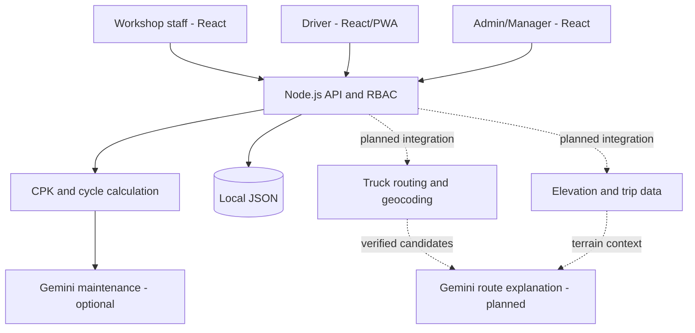

# KiloMetric — Product Direction and Development

> Written by AI from the user's requirements and decisions in this project's conversations. Started: 13 October 2026. Last updated: 16 October 2026. This document is a working guide that must be updated along with the implementation. It is not a statement that the whole plan is finished or approved.

## Full guide to modules and formulas

See [Modules, Data and Formulas](MODULES_AND_FORMULAS.md) for an explanation of each module, its inputs/outputs, data relationships, formulas as implemented in code, worked numbers, unknown/zero rules, snapshots, validation, and API contracts. That guide also distinguishes catalog CPK per unit-kilometer, Mix optimizer group CPK, and order estimates versus actual trips.

## 1. Purpose of the application

KiloMetric helps logistics companies understand the maintenance cost of every kilometer, know the lifespan and cost of every spare part, and choose component brands based on evidence from real use. The next direction is to help drivers choose the fastest route that suits their vehicle and load, while showing an estimate of the trip cost.

The initial data source is real work: a truck enters the workshop, staff record the odometer and the work done, and the system calculates the results. Staff do not need to type CPK figures or guess spare-part lifespans. When the next replacement is recorded, the previous component's life can be closed and its final CPK calculated.

Automatic here means **calculation and updates based on operational records**. Information that does not yet come from sensors or integrations, such as invoice costs, component positions, and load, must still be entered or confirmed by the person responsible.

### Target business outcomes

- Managers see which trucks have high maintenance costs and which records make up that number.
- The workshop compares brands on comparable truck models, usage, categories, and positions.
- Drivers start trips with a clearly selected vehicle, starting location, specifications, and load.
- Dispatchers/managers assess route alternatives based on truck suitability, arrival time, and clearly separated costs.
- Gemini explains the evidence and data gaps so decisions are easy to understand.

## 2. Requirement decisions already given by the user

| Area | Chosen direction |
| --- | --- |
| Technology | JavaScript + React frontend; Node.js backend |
| First version | Local demo with sample data; external services follow when keys are available |
| Main CPK | All recorded maintenance costs divided by kilometers since tracking began |
| Spare-part CPK | Each installation has a life cycle; a replacement ends the previous cycle |
| Best mix | Compare component brands for a truck model and recommend the combination with low CPK |
| Operational start | Starts when a truck enters the workshop and staff fill in the workshop record |
| User access | RBAC: different accounts and permissions for admin, manager, workshop, and driver |
| Before departure | Driver logs in and fills in/confirms specifications and load |
| Trip starting point | Driver location from phone GPS |
| Route priority | Fastest arrival; toll roads allowed |
| Indonesian conditions | Account for uphill and downhill roads, and road suitability for trucks |
| Phone | PWA direction so the app can be installed and use GPS |
| Maps and Gemini | Provide a place to configure keys first |

The truck routing provider, pilot region coverage, fuel data source, and the need for GPS while the screen is locked are still to be decided. The roadmap in this document is an implementation proposal to meet the decisions above.

## 3. Actual project status

Use these four labels when discussing work:

- **Available:** already in the demo code. This does not mean it has been tested in operation at a company.
- **Placeholder:** the configuration shape or initial contract exists, but the service function does not run yet.
- **Planned:** not implemented yet.
- **Needs decision:** business information or a technical choice has not been decided yet.

| Feature | Status as of the reference date | Limits to understand |
| --- | --- | --- |
| Truck and spare-part catalog | Available | Local JSON data; no warehouse stock yet |
| Maintenance records and truck registration on the first visit | Available | Completeness of cost and odometer depends on staff |
| Truck and fleet CPK | Available | Based on recorded maintenance costs |
| Spare-part cycles and CPK | Available | Derived from category + installation position; no physical serial numbers yet |
| CPK display in the spare-part catalog | Available | The summary may combine positions/profiles; use the optimizer for more specific comparisons |
| Mix optimizer | Available | Picks component winners separately; does not yet prove the overall combination |
| Gemini maintenance analysis | Available, optional | Needs a key and model access; not yet verified with live calls |
| Login, RBAC, and truck assignment | Available | Sessions are still in server memory and end when the server restarts |
| Declaration of specifications, load, and trip logging | Available | Technical limits are still user declarations, not manufacturer verification |
| Phone GPS | Available | Foreground, online, location permission; not a background tracker |
| PWA shell and offline page | Available | Installation not yet tested on real phones; no offline input queue |
| Delivery order OCR and assignment | Available, Gemini optional | Drafts need admin review; multi-stop; driver/truck per assignment |
| Google Maps delivery order distance/ETA | Available, needs a key | DRIVE, fixed stop order; truck limits not yet verified |
| Truck route alternatives for drivers (ORS `driving-hgv`) | Available, needs `ORS_API_KEY` | Indonesian OSM restrictions are partial; axle load, bridges, truck bans, operating hours unknown; toll unknown; alternatives only for ≤ ±70 km straight-line; street address geocoding often lands only on the city center |
| Route explanation by Gemini | Available, optional | Only explains provider candidates; ids outside the candidates are rejected; quota/model access determines availability |
| Driver mobile app (React Native/Expo) | Planned, spec in `design.md` | Bearer login, routes, foreground/background GPS, offline queue |
| Web visual map, turn-by-turn navigation | Placeholder | Driver is directed to open Google Maps/Waze |
| Elevation as cost, uphill/downhill cost | Planned | ORS provides total ascent/descent, but there is no calibrated cost model yet |
| Production database, audit trail, multi-company | Planned | Not in the demo yet |

In the delivery order update, 19 automated tests with mock providers and the production build passed. These tests do not prove the accuracy of Indonesian routes, GPS on real devices, PWA installation, or the quality of live Gemini answers. The delivery order runtime update is described in section 21.

## 4. Terms and calculation boundaries

The **spare-part catalog** is the product definition: SKU, name, brand, category, model compatibility, and default price. One SKU can be used many times on many trucks.

An **installation** is the event of a product being fitted to a specific truck, at a specific position, with an odometer reading, date, quantity, actual price, and installation cost. The life history is attached to this installation, not only to the product name.

A **component cycle** starts at installation and ends when that position is replaced. A component still in use has no known final lifespan yet.

**Actual maintenance CPK** comes from costs that have already been recorded. The **estimated trip maintenance cost** uses historical CPK to allocate an estimated cost to the trip distance. These two numbers are different and must not be added together as a new expense.

The **total trip cost** can include maintenance, fuel, tolls, and other costs. The older GPS trip estimate remains maintenance only. The delivery order module now separates maintenance, fuel, and toll estimates as well as the total trip CPK; see the update below.

The demo currency is IDR. Odometer distance uses kilometers. Users do not need to enter CPK manually.

## 5. Workshop workflow as the foundation

### 5.1 First visit

1. Workshop staff log in with the Workshop role.
2. Choose a registered truck or register a new truck directly in the maintenance form.
3. Fill in the plate, model, usage profile, date, odometer, and workshop.
4. Add the work: spare part, position, quantity, actual price, and installation cost.
5. Fill in general labor cost and other maintenance costs without counting again the installation costs already entered on the component lines.
6. Check the cost summary and save.
7. The system saves the truck and the visit together, sets an automatic baseline for the new truck, and opens cycles for the installed components.

At the initial odometer, the tracked distance is still zero, so CPK shows as not yet known. The cost of the first visit is still saved as part of the total cost since tracking began. This is the demo's accounting definition; it is not a claim about all costs since the truck was purchased.

### 5.2 Later visits

Staff choose the truck, enter the new odometer, then record the work and the prices actually paid. The system updates the odometer, cumulative cost, and truck CPK.

If the same category and position is installed again, the old cycle is closed even if the brand is different. A new cycle is opened for the replacement component. Replacing the front-left tire must not close the front-right tire's cycle.

### 5.3 Data correction

Editing or deleting a visit causes derived numbers to be recalculated. For trucks registered through the workshop, an earlier visit added later can move the automatic baseline. The baseline of a truck previously registered manually is kept.

Odometer readings reported separately, including during trips, are kept when workshop records are corrected. The system validates the relationship between dates and odometer readings. In the future, changes like this must have a correction reason and an audit trail; the audit trail is not available yet.

## 6. CPK formulas and examples

### 6.1 Visit cost

```text
Component line cost = quantity × actual unit price + line installation cost
Visit cost = sum of all line costs + general labor + other costs
```

The catalog price is the default for filling in. The price saved on the visit is the basis of calculation. Changing the catalog price does not change maintenance invoices already saved.

### 6.2 Truck CPK

```text
Tracked distance = current odometer − baseline odometer
Truck CPK = total recorded maintenance cost / tracked distance
```

Example:

| Event | Odometer | Maintenance cost |
| --- | ---: | ---: |
| First visit | 100,000 km | Rp1,000,000 |
| Second visit | 110,000 km | Rp1,500,000 |

Distance = 10,000 km. Cost = Rp2,500,000. CPK = **Rp250/km**. If the odometer is later reported as 112,000 km with no new cost, CPK becomes about **Rp208.33/km** because the distance has increased.

Zero CPK is not a substitute for zero distance. If distance is not yet available or is zero, show not yet known. Fuel, truck purchase, and toll costs are not included in maintenance CPK at this time.

### 6.3 Fleet CPK

```text
Fleet CPK = total maintenance cost of all trucks / total tracked distance of all trucks
```

Example: truck A spends Rp2,000,000 over 10,000 km, truck B Rp9,000,000 over 30,000 km. Fleet CPK = Rp11,000,000 / 40,000 = **Rp275/km**. The simple average of Rp200 and Rp300 is Rp250/km, which is not correct for the fleet total.

Costs already recorded on a truck with zero distance are still fleet expenses. The dashboard needs to keep the context that some vehicles do not yet have enough tracked distance.

### 6.4 CPK of one spare part

```text
Kilometer lifespan = replacement odometer − installation odometer
Cycle CPK = component installation cost / kilometer lifespan
```

Front-left tire example: price Rp4,000,000, installation cost Rp200,000, installed at 100,000 km and replaced at 160,000 km. Its lifespan is 60,000 km. Final CPK = Rp4,200,000 / 60,000 = **Rp70/km**.

General labor cost for a visit still enters truck CPK, but it is currently not allocated to the ranking of each spare part. Because of this, the sum of all component CPKs does not automatically equal truck CPK.

### 6.5 Grouped installation records

If staff enter two tires on one line, with quantity 2 and position `front axle pair`, the system has one shared cycle record. For example, a total cost of Rp8,400,000 and a distance of 60,000 km:

- Group CPK = Rp140/km.
- Per-unit CPK = Rp70/km, with the cost split evenly and the same lifespan assumed.

This does not prove that both physical tires have identical individual lifespans. To track each tire, use quantity 1 with different positions, for example `front-left tire` and `front-right tire`.

The catalog summary uses:

```text
Catalog per-unit CPK = Σ completed cycle cost / Σ(unit quantity × kilometer lifespan)
Average lifespan = Σ(unit quantity × kilometer lifespan) / Σ unit quantity
```

Only completed cycles with positive distance enter that aggregation. Active components and cycles completed at zero distance are not used as evidence of final lifespan.

## 7. Spare-part history and best mix

### Existing behavior

The current cycle matching identity is **truck + category + position**. Position ignores differences in upper/lower case and leading/trailing spaces. Different terms, for example `depan kiri` and `front-left`, are still treated as different; automatic language normalization does not exist yet.

The Spare parts & CPK page provides a CPK summary, average lifespan, number of completed cycles/units, active units, a model filter, and cycle details. The Mix optimizer separates comparisons by model, usage profile, category, and position.

The combination recommendation is built from the component choices with the lowest observed CPK in comparable groups. This recommendation does not yet measure interaction effects between components or prove the savings of one combination across all vehicles.

### Suggested improvements

1. Provide standard position choices per model/configuration so staff do not need to type free-text positions.
2. Give each physical installation a permanent ID; add a serial number when the component actually has one.
3. Separate installation, removal, replacement, rotation, repair, and reuse events.
4. Store the end-of-life reason: normal wear, damage, accident, or preventive replacement.
5. Store a snapshot of the model/profile/category configuration at transaction time so master data changes do not silently change the classification of history.
6. Show the sample count, lifespan distribution, and route/load context before saying one brand is better.

Tire rotation between positions or moving components between trucks is not yet supported by the current simple cycle model. Do not fabricate replacement records to represent them. The physical event model needs to be developed first if that flow is needed.

## 8. Users and RBAC

| Action | Admin | Manager | Workshop | Driver |
| --- | --- | --- | --- | --- |
| Manage trucks, catalog, maintenance | Yes | Yes | Yes | No |
| Read truck data | All | All | All | Assigned trucks |
| Trigger manual Gemini analysis | Yes | Yes | No | No |
| View trips | All | All | No | Own |
| Start/send GPS/complete trips | No | No | No | Own, assigned truck |
| Manage accounts and assignments | Yes | No | No | No |
| Delivery order OCR, review, and assignment | Yes | No | No | No |
| Read delivery orders | All | No | No | Own |

Restrictions must apply on the server, not only by hiding buttons. The driver receives data for assigned trucks, the compatible catalog, and the related maintenance history; the driver gets no write access to workshop records or to other drivers' trips.

Accounts are created by the admin. Passwords use salted scrypt hashes. Session cookies use HttpOnly and SameSite=Strict; the Secure option is prepared for HTTPS. Sessions end after 12 hours or on server restart. Account changes revoke that account's sessions. The system prevents losing the last active admin.

Dispatcher is not yet a separate role. For now, trip supervision belongs to Manager/Admin. If a company needs a separate dispatcher, the access matrix must be extended explicitly.

Demo accounts have public passwords as listed in the README. For real use, bootstrap a non-demo admin and change/disable the sample accounts. Changing `DEMO_MODE` on an existing database does not automatically replace those accounts.

## 9. Current driver trip flow

1. Log in and choose one of the assigned trucks.
2. Get the starting location from GPS with the driver's permission.
3. Enter the destination, departure odometer, vehicle height/width/length, number of axles, empty weight, maximum permitted weight, load weight, and dangerous goods classification.
4. Confirm the specifications and load for that departure. Previously saved data helps fill in the form, but the load for a new trip must still be entered.
5. Because routing is not connected yet, confirm that the route has been approved by the dispatcher through external planning.
6. Start trip logging and press Resume live GPS so the location is sent while the app is visible and online.
7. On arrival, enter the actual odometer and complete the trip.

One driver or truck may have only one active trip. Empty weight plus load must not exceed the declared maximum weight. This does not yet validate per-axle load or confirm that the declared limits match manufacturer documents.

The starting location must be fresh and accurate to within 100 meters. The backend rejects invalid location data, ignores repeated/non-increasing timestamps, and filters out implausible jumps. GPS distance is an approximation from the accepted points and differs from road distance or odometer distance.

Departure/arrival odometer readings update the truck's distance for CPK. GPS does not automatically replace the odometer as the official source. The recent point history is limited to 10,000 points per trip; cumulative GPS distance is kept separately. The polling summary sends the last location and the number of points, not the whole track.

```text
Trip maintenance estimate = historical CPK at departure × trip odometer distance
```

For example, a CPK of Rp250/km and a 400 km trip give an estimate of Rp100,000. This number is not a new invoice and is not added to the CPK numerator. Fuel, tolls, and elevation effects are not yet included.

## 10. Routing design for Indonesia

### 10.1 Decision order

The user's priority is the fastest arrival time, with tolls allowed. However, alternatives must first meet vehicle and road limits.

```text
Starting location + destination + truck/load snapshot
  → geocoding and route candidates from the truck routing provider
  → verify limits/restrictions and data completeness
  → remove unsuitable candidates
  → sort feasible candidates by ETA
  → show a comparison of distance, toll, elevation, estimated cost
  → Gemini explains based on candidate data
  → driver/dispatcher chooses and saves the plan
```

If no candidate can be verified, the app must say that no route can be recommended from the available data. A straight line, an ordinary car route, or a Gemini guess must not be labeled as a verified truck route.

### 10.2 Proposed inputs and outputs

| Input | Purpose |
| --- | --- |
| Verified start and destination coordinates | Defines the correct trip |
| Overall vehicle and load dimensions | Height, width, and length limits, and access suitability |
| Total weight and axle configuration/load if available | Road and bridge restrictions |
| Dangerous goods and vehicle class | Special restrictions, depending on provider support |
| Departure time | ETA and time-based restrictions if supported |
| Toll policy | Tolls allowed, per the user's decision |

The plan output needs to include route geometry, distance, ETA and the time it was retrieved, the provider, limits already checked, limits still unknown, toll cost when available, elevation profile, and the reason for the recommendation. Plan data is saved as a snapshot so the chosen route can be audited after service conditions change.

### 10.3 Maps are different from truck routing

Maps display roads. Geocoding turns addresses into coordinates. Truck routing finds routes within vehicle limits. Elevation provides terrain height. Traffic data updates the ETA. One API key does not automatically provide all of these capabilities.

Choose a provider after checking its coverage of **truck restrictions in the Indonesian operating region**, not only the availability of Indonesian maps. Test routes known to dispatchers, including warehouse access, bridges, height limits, truck bans, and operating hours.

In the documentation referenced by this project, Google large-vehicle routing documents coverage for the contiguous US and Japan, so that capability must not be assumed to cover Indonesia. Service coverage and access need to be checked again when choosing a provider. See the [large-vehicle routing documentation](https://developers.google.com/maps/documentation/routes/lvr).

### 10.4 Uphill and downhill

Elevation must be taken along the road geometry, not only from the height difference between the start and destination. A route that returns to its starting altitude can still have many climbs and descents.

```text
Segment grade (%) = elevation change / segment horizontal distance × 100
```

The calculation needs to control elevation noise, sample resolution, and segments that are too short. Useful measures include total ascent, total descent, length of steep segments, and load conditions while passing them.

Climbs can affect energy consumption, while descents can affect braking needs. The size of the cost cannot be determined from the positive/negative sign of elevation alone. Model, load, speed, road condition, traffic, and driving technique also have an effect.

Do not create constants such as "a climb adds 30% to CPK" without calibration. For the initial version, show the terrain profile and its limitations. Terrain-based money estimates come later, after operational data is available and the model has been tested.

## 11. Gemini's role

### What is already done

The backend can send Gemini a summary of costs, distances, the compatibility catalog, and completed component cycles when a key is configured. Data changes trigger an up-to-date analysis with a debounce; the revision status helps mark results that have not caught up with the latest data. AI failures do not cancel saving maintenance.

This is providing up-to-date context, **not retraining or fine-tuning the model every time there is a new spare part**. A new product without completed cycles does not yet have lifespan evidence from the company.

### Division of responsibility

| Responsibility | Performed by |
| --- | --- |
| CPK formulas, cost totals, cycle lifespan | Deterministic backend code |
| Access rights, load validation, trip ownership | Backend |
| Roads, geometry, ETA, supported restrictions | The chosen routing/data provider |
| Elevation profile | Elevation provider and geometry processing |
| Explaining comparisons and evidence gaps | Gemini |
| Confirming fitment and operational feasibility | Workshop/dispatcher, per the company's responsibilities |

For routing, Gemini may only be given candidates that come from the provider, with clear check results. Its answer must refer to the numbers and candidate IDs that are available. The code must validate that the recommended candidate actually exists and passes the checks before it is shown.

Gemini must not invent component compatibility, brand lifespan without evidence, toll costs, bridge status, route geometry, or savings percentages that have not been calculated. If the AI fails, the app still shows the available numbers and verified candidates.

Additional plan: store the model version, analysis time, data revision, input summary, and response validation results. Full provenance logging for analyses/routes is not implemented yet.

## 12. Current architecture and next direction



The frontend handles forms, display, and GPS permission. The backend authorizes every request, validates data, runs calculations, and saves changes. The Gemini key and server service keys are kept in the backend. If a provider needs a public key for the browser, use a dedicated key with origin and capability restrictions as described in the provider's documentation; do not move server secrets into the frontend bundle.

Local JSON is enough for a single-server demo. Changes are serialized and written through a temporary file and then renamed. This is not yet a foundation for multiple instances or a production transactional database.

### File map for developers

| File | Responsibility |
| --- | --- |
| `server.js` | HTTP API, Gemini integration, route authentication, frontend serving |
| `lib/auth.js` | Roles, passwords, sessions, user data filtering |
| `lib/workshop.js` | Maintenance saving/correction and mileage sync |
| `lib/validation.js` | Fleet and maintenance data validation |
| `lib/analytics.js` | Cost, CPK, component cycles, and comparisons |
| `lib/trips.js` | Truck declaration, trips, GPS validation, and odometer |
| `lib/orders.js` | OCR, orders, assignment, Google distance, cost estimates, and trip linking |
| `src/orders.jsx`, `src/orders.css` | Admin delivery order UI |
| `lib/seed.js` | Initial illustrative data |
| `src/main.jsx`, `src/style.css` | CMS and main UI |
| `src/driver.jsx`, `src/driver.css` | Driver flow and trip supervision |
| `public/manifest.webmanifest`, `public/sw.js` | PWA identity and offline fallback |
| `test/` | Automated tests for business rules and the API |
| `.env.example` | Configuration template without real keys |
| `data/fleet.json` | Local runtime data; not to be committed to Git |

### Key current API contracts

| Endpoint/group | Purpose |
| --- | --- |
| `/api/session`, `/api/login`, `/api/logout` | Identity and session |
| `/api/state` | Data and analytics filtered by role |
| `/api/users` | Account management by the admin |
| `/api/trucks`, `/api/parts`, `/api/maintenance` | Master data and maintenance operations per role |
| `/api/trips` and its sub-routes | Driver-owned trips, locations, and completion |
| `/api/analyze` | Maintenance analysis request by admin/manager |
| `/api/orders` and its sub-routes | Admin OCR, review/assignment, automatic distance, and order estimates |
| `/api/routes/preview` | Placeholder; valid input still returns unavailable/503 with no route candidates |

This table is a summary of responsibilities, not a full payload specification for each endpoint. Contract changes must be checked against the related handler and tests.

### Proposed production data model

Separate the entities for users/assignments, trucks/configuration versions, product catalog, component positions, physical installations, maintenance visits/lines, removal/rotation events, trips/load snapshots, GPS points, route plans/segments, AI analyses, and audit events.

A relational database such as PostgreSQL can be considered for relations, transactions, indexes, and migrations. The choice has not been decided by the user. Migration must keep IDs and historical price values, and must be verifiable against CPK before/after migration.

## 13. PWA and phone GPS limits

The current PWA shell includes a manifest, icons, an install control, a service worker in the production build, and an offline status page. The service worker caches the public assets needed for the fallback; authenticated API responses and GPS data are not cached. There are no offline forms or resend queue yet.

The phone must access a reachable HTTPS address. `localhost` on a phone points to the phone itself, not the developer's computer. Installation and GPS on phones need testing through a suitable deployment.

**The current PWA only supports GPS while the app is active/visible.** A locked screen, switching apps, revoked permission, lost connection, or an expired session can stop sending. The display must show the status and age of the last location so managers do not treat an old point as a live position.

If a company needs continuous tracking during a trip while the phone is locked, evaluate a native/wrapper app with background location capability or a telematics device. A web service worker must not be assumed to provide continuous background GPS.

For the next offline phase, design a device-appropriate encrypted queue, idempotency IDs, handling of expired sessions, timestamps, odometer conflicts, and data deletion on logout. This is additional work, not a capability that is already available.

References: [Geolocation watchPosition](https://developer.mozilla.org/en-US/docs/Web/API/Geolocation/watchPosition), [Geolocation specification](https://www.w3.org/TR/geolocation/), and [PWA installation requirements](https://developer.mozilla.org/en-US/docs/Web/Progressive_web_apps/Guides/Making_PWAs_installable).

## 14. Configuration, storage, and operations

| Variable | Function/status |
| --- | --- |
| `GEMINI_API_KEY` | Enables the maintenance analyst that is already implemented |
| `GEMINI_MODEL` | Name of a generateContent model available to the account; verify before use |
| `MAPS_API_KEY` | Google Routes distance/ETA adapter for delivery orders; visual map and truck restrictions not yet available |
| `GEMINI_OCR_MODEL` | Optional override for the extraction model; defaults to GEMINI_MODEL |
| `TRUCK_ROUTING_PROVIDER`, `TRUCK_ROUTING_API_KEY` | Routing provider slot; adapter not yet available |
| `ELEVATION_API_KEY` | Elevation slot; adapter not yet available |
| `PORT`, `HOST` | Server address; defaults to loopback for the demo |
| `APP_ORIGIN`, `COOKIE_SECURE` | Origin and cookie configuration for HTTPS deployment |
| `DEMO_MODE`, `ADMIN_EMAIL`, `ADMIN_PASSWORD` | Demo mode/initial account bootstrap |

Do not write real keys or production passwords in documents, commits, screenshots, or API responses. `.env.example` is only a template. Model availability, quota, API cost, and provider coverage must be checked during integration; this document does not set service prices.

The UI backup is a snapshot of business data for review, not a full recovery backup. For a full recovery today, stop the server and copy `data/fleet.json` securely. That file also contains account data and location history. The restore procedure needs to be tested before a production pilot.

Steps to run the app are in the [README](README.md). In short:

```sh
npm install
npm run dev
```

Open `http://localhost:3000`. For checks and build:

```sh
npm test
npm run build
npm start -- --production
```

## 15. Roadmap with completion criteria

The order below is a recommendation. Phases that need a provider/key can have their contracts prepared first, but live route claims wait for real data.

### Phase A — Validate the available maintenance flow

**Goal:** staff can record real work and trace CPK numbers.

Work: test several representative visits, consistency of position terms, actual prices, general costs, odometer corrections, and adding a truck during a visit.

**Done when:** sample costs can be reconciled with workshop records; the first visit does not produce a false CPK; a brand change closes the correct cycle; corrections do not break mileage reported through trips.

### Phase B — Strengthen physical spare-part tracking

**Goal:** one component has a traceable history even when moved or repaired.

Work: standard positions, installation IDs, master data snapshots, removal reasons, and correction audit. Add rotation/reuse only after the need is confirmed. Keep labels for old grouped data.

**Done when:** replacing one tire does not close another tire; installation history stays stable after master data is edited; agreed rotation cases are not counted as false completed lifespans; migration results match the approved calculation baseline.

### Phase C — Driver and PWA pilot on real devices

**Goal:** login, load declaration, foreground GPS, and trip completion work on the target phones.

Work: limited HTTPS deployment, non-demo accounts, testing on the Android/iPhone models in use, denied/revoked permissions, lost connection, expired sessions, and trip resume. Decide whether foreground is enough for the business.

**Done when:** access between drivers stays isolated; overloads are rejected; old points are flagged; trips can continue after disruptions; the background need gets a clear architecture decision.

### Phase D — Integrate truck-suitable fastest routes

**Goal:** replace the placeholder with real route alternatives that have provenance.

Work: choose a provider and verify pilot region coverage; implement geocoding, maps, truck routing, ETA, and snapshots. Add elevation if data is available. Gemini explains the alternatives that have been checked.

**Done when:** candidates that break known limits are removed; the fastest feasible candidate is prioritized with tolls allowed; rejection reasons and unknown limits are visible; provider failure produces a clear status; no fictitious routes when the key is empty.

### Phase E — Evidence-based trip cost estimates

**Goal:** separate maintenance, fuel, and toll projections in a testable way.

Work: decide the sources of actual fuel and toll data, combine load/terrain context, measure prediction error, and validate on trips not used for calibration. Separate illustrative data from company data.

**Done when:** each cost component has a source and unit; the uncertainty range can be explained; estimated costs do not enter actual costs; terrain effects are tested with data, not guessed multipliers.

### Phase F — Company operational readiness

**Goal:** run the app with real data and clear recovery procedures.

Work: database/migration, audit trail, persistent sessions, monitoring, restore drill, restricted access to location data, data retention, and operational mechanisms when a provider fails. Add multi-company only if it is actually needed.

**Done when:** restore has been tested successfully; access rights and data changes can be audited; the system communicates outages; access to and retention period of location data are agreed; capacity is tested for the pilot's number of users/trucks.

## 16. Key acceptance scenarios

| Scenario | Expected result |
| --- | --- |
| New truck, first visit | Cost saved, automatic baseline, CPK not yet known |
| Second visit with a higher odometer | CPK calculated from all costs and the odometer difference |
| Catalog price changes | Old actual maintenance prices stay the same |
| Left tire replaced with a different brand | Old left tire cycle completed; right cycle stays active |
| Record of two tires on one line | Still labeled as a group; per-unit stated as an allocation |
| Spare part never replaced | Active, with no fabricated final lifespan or lifespan ranking |
| Two trucks travel different distances | Fleet CPK uses the total ratio, not a simple mean |
| Driver accesses a truck/trip that is not theirs | Server denies access per assignment/ownership |
| Total weight exceeds the declared limit | Departure rejected |
| GPS denied, too old, or inaccurate | Clear status; departure requirements are not silently skipped |
| Repeated GPS or implausible jumps | Does not add distance invalidly |
| Trip completed | Odometer updates CPK; the trip estimate does not become a new maintenance cost |
| Gemini fails | Maintenance records stay saved; analysis shows failure/stale |
| Routing not connected | Unavailable, with no invented ETA or roads |
| Fast route passes under a height limit that is too low | In the routing phase, the candidate is rejected before choosing the fastest |
| Phone offline/screen locked | Tracking limits are visible; the last location is not claimed as live |

The routing and real-device scenarios in this table are future test criteria. Do not say they have all passed just because the demo unit tests pass.

## 17. Data quality and interpretation

A low CPK can happen because maintenance records are incomplete, the odometer is too high, or the tracking period is short. Brand comparisons can be affected by load, roads, operators, and replacement reasons. Sample data must not be used for real purchasing decisions.

Cost completeness, odometer source, number of cycles, and usage profile need to be visible together with the results. A sample count is not by itself a measure of statistical certainty. Active performance is not the same as final lifespan; components still in service must not be treated as failures or carelessly dropped from the understanding of risk.

Not all road data has the same completeness or freshness. Show sources and limitations so dispatchers can do operational checks. "Truck-suitable" must be explained as a check against the available limits, not a guarantee that all road conditions are known.

## 18. Decisions still needed

1. **Pilot region:** city/province, trip types, warehouse access, and frequently used road segments.
2. **Routing provider:** candidates with Indonesian truck-restriction coverage, suitable usage license, and cost.
3. **Background GPS:** is it enough while the app is open, or must it keep running while the screen is locked?
4. **Fuel data:** are liters, price, refueling odometer, telematics available, or only aggregate bills?
5. **Toll data:** provider estimates, actual transactions, or driver/staff input?
6. **Component identity:** is position alone enough for the pilot, or are serials, tire rotation, repair, and transfers between trucks needed from the start?
7. **Specification source:** who approves manufacturer limits, vehicle documents, and per-axle load?
8. **Dispatcher role:** use Manager or a dedicated role?
9. **Location data:** who may see detailed tracks and how long are they kept?
10. **Scale and hosting:** initial number of trucks/users, need for many branches/companies, and the deployment environment.

Answers can be added gradually; maintenance work that does not depend on these decisions can continue.

## 19. How to use this document with Codex

The user can give instructions directly through the conversation. Example:

> Read PRODUCT_DIRECTION.md. Do Phase B for standard spare-part positions first. Keep historical actual prices and the CPK calculation. Update the document status and related tests, then explain the changes and their limits.

Or:

> I have chosen a routing provider and have a key. Implement the Phase D adapter based on the provider's official documentation, keep the secret in the backend, and show unavailable if the service fails.

Before a phase is called done, update the status matrix, record the validation that was actually run, and explain what has not been tested. The README remains the guide to running the app; this document is the reference for goals, business rules, and development order.

## 20. Technical references

- [Project README](README.md): running the app, demo accounts, configuration, and implementation limits.
- [Gemini generateContent](https://ai.google.dev/api/generate-content): API reference for the AI analyst.
- [Google large-vehicle routing](https://developers.google.com/maps/documentation/routes/lvr): check service coverage and limits before choosing a provider.
- [MDN Geolocation watchPosition](https://developer.mozilla.org/en-US/docs/Web/API/Geolocation/watchPosition): browser GPS permission and usage.
- [W3C Geolocation](https://www.w3.org/TR/geolocation/): behavior and limits of web geolocation.
- [MDN PWA installation](https://developer.mozilla.org/en-US/docs/Web/Progressive_web_apps/Guides/Making_PWAs_installable): installation requirements for web apps.

External service references can change. Check the official documentation again at implementation time; the date of this document is not a guarantee of future service capabilities.


## 21. Update 15 October 2026 — Delivery orders, OCR, and trip estimates

### Additional user requirements

The admin uploads a delivery order/surat jalan (delivery note). Gemini reads the document into a list of orders with several destinations, then the admin assigns a driver and a truck. Distance must come automatically from Google Maps, not manual input. The cost estimate covers maintenance, fuel, and tolls.

### Implemented flow

1. The admin opens **Delivery orders**, selects a PDF/JPEG/PNG/WebP (maximum 8 MiB), then presses Extract. The document is sent to Gemini on that action.
2. The structured response is fully validated before saving. One document can produce a maximum of 20 drafts, each order 1–10 stops and a maximum of 100 cargo lines. There is no automatic assignment based on document text.
3. The admin compares against the original document and corrects the reference, pickup, customer, date, every address/recipient, goods, quantity, unit, and weight where available. Values that cannot be read must not be made up.
4. The admin chooses an active driver and a truck already assigned through People & access. The order weight is checked against the declared capacity if specifications are available. Review is required before the assignment is saved.
5. When a reviewed order is saved, the frontend automatically requests Google Routes if a key is configured. The pickup, intermediate stops, and final stop are sent in the reviewed order. There is no manual distance input field.
6. The system calculates maintenance from the truck's history, fuel from the efficiency and price entered by the admin, and tolls from the admin override or the Google driving price in IDR if available.
7. The driver sees their own order, chooses Use this delivery order, then completes the checks and GPS. All stops are attached to the trip, with the final stop as the main destination.
8. Starting/completing the trip changes the order status to in transit/completed. This is not proof of receipt at each stop; proof of delivery and partial delivery are not available yet.

### Formulas and sources

```text
D = Google Maps distance, kilometers
M = truck historical maintenance CPK × D
F = (D / efficiency km per liter) × price IDR per liter
T = admin toll override if filled in, or Google driving toll estimate if available
Total estimate = M + F + T
Estimated trip CPK = (M + F + T) / D
```

Example: D 240 km, maintenance Rp250/km, efficiency 4 km/liter, fuel Rp10,000/liter, toll Rp150,000. M Rp60,000 + F Rp600,000 + T Rp150,000 = Rp810,000, with a trip CPK of Rp3,375/km. Maintenance CPK stays Rp250/km in that snapshot.

If any component is unknown, the total stays unknown. A zero toll must be explicit, not assumed because Google did not return a price. Projected numbers are not added to actual maintenance expenses. Fuel uses the admin's load assumption; there is no terrain/telematics calibration yet.

### Integration limits that still apply

- The Google adapter uses traffic-aware DRIVE, with tolls allowed. Driving routes do not validate truck height/weight/axle limits in Indonesia. Driving toll prices can differ from the truck class; use an override that has been checked.
- Stop order follows the input; there is no stop order optimization, return trip, or loading/unloading time yet. The driving ETA is calculated at request time, not a promised receipt time on the delivery date.
- Gemini reads documents; kilometers and costs are calculated by Google/the backend. Gemini does not guess distances or retrain itself from documents.
- Truck-safe navigation, elevation, and Gemini route analysis adapters remain on the roadmap, even though the order distance adapter exists.
- An empty key shows not configured. A failed call keeps the order already saved. Live testing with a real API key has not been done yet.
- The admin can assign an order even if the estimate is still unknown. The driver still needs external route approval; the estimate is not road approval.
- One order is linked to one trip. Merging several orders into one trip, cancellation, proof of delivery, and per-stop status are not implemented yet.

### Storage and access

`lib/orders.js` handles validation, OCR, Maps requests, assignment, cost, and trip linking. `src/orders.jsx` and `src/orders.css` handle the admin UI. `server.js` provides `/api/orders`, `/api/orders/extract`, `/api/orders/:id`, and `/api/orders/:id/estimate`. `test/orders.test.js` tests those contracts using mock providers.

Runtime data migrates by adding `orders: []` and schemaVersion 3 without deleting old history. The original document is not stored: only the extraction result, source metadata, hash, warnings, and time. Identical uploads are rejected based on the hash. Store the original document separately if the company's process needs it.

The admin manages orders. The driver only reads their own orders; OCR source metadata is not sent to the driver view. Manager and Workshop get no order data in this version. Order changes use a version number; Maps results that arrive after the order has changed are rejected. Editing an order deletes the old estimate. After the trip starts, the order and dispatch estimate are frozen.

### Additional validation

Tests cover wrong file type/too large, invalid/truncated OCR output, extraction of several orders, duplicate protection, required review, wrong assignment, stale edits, Google waypoint order, partial match addresses, provider errors, unknown cost components, zero toll override, role isolation, trip cargo less than the order, snapshot of all stops, and persistence of the completed status. These tests use mocks, so tests with real documents, keys, billing, Indonesian addresses, and device UI are still needed.

### Next steps

Configure GEMINI_API_KEY and MAPS_API_KEY with the Routes API enabled; GEMINI_OCR_MODEL is optional. Test one real surat jalan that may be processed, review all addresses, then match the distance and toll estimate against company operations. Decide a representative loaded fuel efficiency for each truck. After the basic flow is validated, continue with choosing truck routing and terrain calibration as in the earlier roadmap.

Implementation references: [Gemini generateContent](https://ai.google.dev/api/generate-content), [Google computeRoutes](https://developers.google.com/maps/documentation/routes/compute_route_directions), and [intermediate waypoints](https://developers.google.com/maps/documentation/routes/intermed_waypoints).

## 22. Update 16 October 2026 — Driver app and route alternatives

### Decision

The team is building a driver mobile app (React Native + Expo) and connecting Gemini with maps. The division of responsibility stays as in §11: the routing provider computes route candidates, Gemini only explains. A Google Maps key is not available, so the provider used is OpenRouteService with the `driving-hgv` profile, with clearly labeled sample (fixture) routes as the fallback. The full app specification and API contract are in `design.md`; the design plan is in `docs/plans/2026-10-16-driver-app-routing-design.md`.

### Implemented in the backend

- Mobile login: `POST /api/login` with `client: "mobile"` returns a token for the `Authorization: Bearer` header. Session storage, the 12-hour validity, and revocation are the same as the web cookie.
- `POST /api/routes/preview` replaces the 503 placeholder: stop geocoding, truck route candidates with the declared dimensions and weight, a validated Gemini explanation, and the fixture fallback.
- `routePlan`: a snapshot of the route the driver chose is saved on `trip.routing.plan` when the trip starts. External dispatcher approval is still required.

### Live test findings (16 October 2026)

| Test | Result |
| --- | --- |
| Jakarta Selatan → Cikarang (±36 km straight-line) | 3 alternatives, 49–54 km, 55–58 minutes |
| Jakarta Selatan → Kawasan Industri Pulogadung (Pulogadung Industrial Estate) | 3 alternatives, geocode `exact` (venue) |
| Jakarta Selatan → Bandung (168 km) | ORS rejects alternatives above ±100 km; one 168 km/144-minute route with a warning |
| Multi-stop with a point in the sea | ORS returned 3108 km; now dropped by the plausibility check |
| Geocoding "Jl. Asia Afrika No. 8, Bandung" | Only Bandung city center (confidence 0.6) → flagged `approximate` |
| Geocoding "Pelabuhan Tanjung Priok" (Tanjung Priok Port) | Wrong place (Muara Angke) with confidence 1.0 → the result label must be shown to the driver |
| Gemini `gemini-3.8-flash` | Key quota exhausted (429) during testing; the AI card shows "tidak tersedia" (unavailable) and routes still show |

### Limits that still apply

Per-axle load is not declared, so it is not sent to the provider and is shown as not yet known. Bridge limits, truck bans, and operating hours are not checked. Toll is unknown. Route alternatives are only for short trips. Order addresses need to name a known place (industrial estate, named warehouse) for accurate geocoding. Route candidates are provider estimates, not road approval.

## 23. Update 17 October 2026 — Route cost, road condition, and odometer photos

Design: `docs/plans/2026-10-17-route-cost-odometer-ocr-design.md`. API contract: `design.md` §4.6, §4.7, §4.9–§4.11.

### Implemented

- **CPK is more prominent** in the driver app: pre-trip, trip details, and account.
- **Road condition per route** from ORS `extra_info` (surface, waytype, steepness): km paved, damaged, unknown, uphill, and ferry.
- **Cost per route.** Maintenance = truck historical CPK × km, fuel = km ÷ km/l × price/l from the order, toll not yet known. Unknown components make the total unknown too.
- **Rough-road factor** set by the admin (1–3, or blank). This factor multiplies CPK only on rough-road km. Its value is an uncalibrated assumption and is always shown with the result.
- **Route recommendation is decided by the backend.** The route with the lowest total cost is chosen if all routes have a total; otherwise, the fastest route. Gemini only explains, and an answer that recommends a different route is rejected.
- **Odometer photos** at departure and arrival. Gemini reads the number, the backend compares (±1 km). If it does not match or cannot be read, the driver must give a reason. The typed number stays official. Evidence is stored in `trip.odometerEvidence`, and the web trip register flags mismatches.

### Test findings (17 October 2026)

| Test | Result |
| --- | --- |
| ORS `extra_info` + alternatives, Jakarta demo routes | 4–7 seconds; surface mostly asphalt/concrete or unknown (up to 53%), almost no damaged segments. The rough-road factor rarely changes the demo cost |
| Clean LCD odometer OCR (synthetic image), `gemini-flash-lite-latest` | Read exactly (124587), ±2 seconds |
| 7-segment OCR with faint dead segments | Lite misread (2458) → *mismatch*, never a false *match*. The flash model thought for >20 seconds then timed out. Lite stays in use |
| Android emulator camera | Returns an image of a virtual room → *unreadable*; the emulator demo uses the gallery (dev mode only) |

### Limits

OCR accuracy on real odometer photos has not been tested. The test images above are synthetic, so real truck dashboard photos are needed before the pilot. OSM road surface data in Indonesia is often empty, so "unknown" km are not counted as rough road. The rough-road factor has not been calibrated with workshop data.
